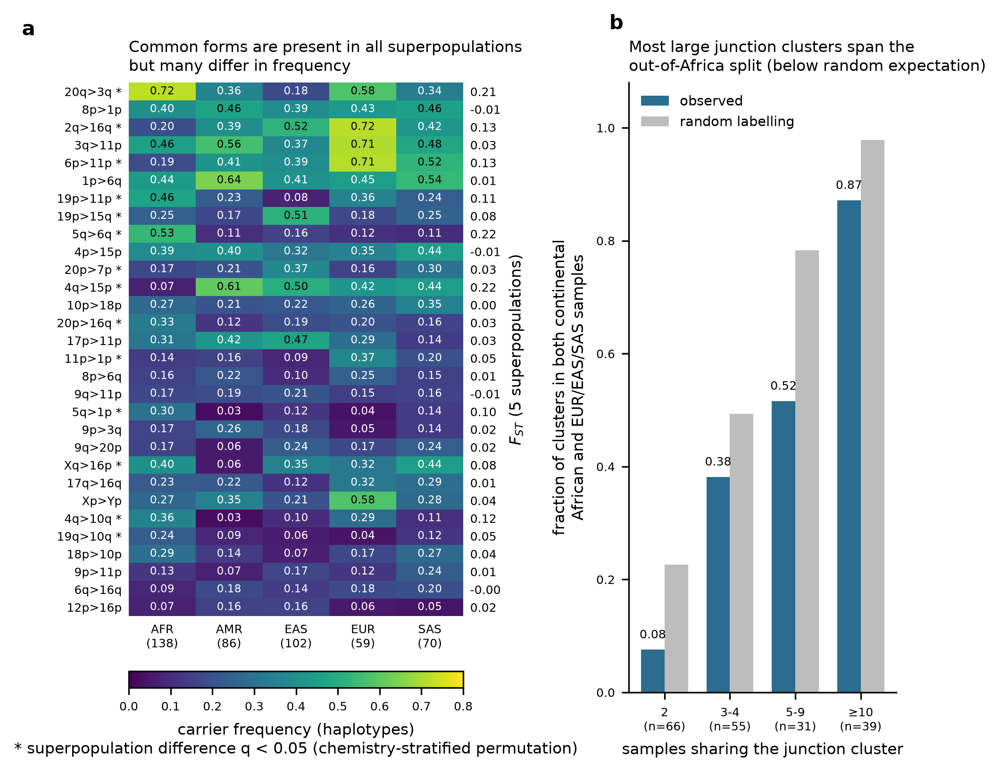
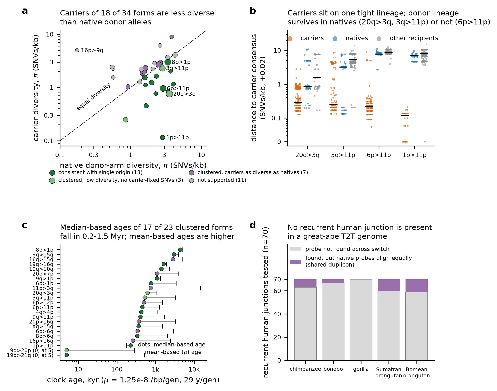

# Population distribution, single origin and relative age of foreign subtelomere forms

A *foreign form* `A>B` is a Release 2 haplotype whose chromosome arm A ends in a terminal block that matches CHM13 v2.0 arm B
better than A (the upstream tip table `subtel_foreign_tips.tsv` gives 4,594 of 11,998 chromosome-named tips; 347 forms).
This track tests three things:

- whether forms differ in frequency among 1000 Genomes superpopulations;
- whether carriers of a form descend from one ancestral block (single origin), and how old that block is relative to the
  donor arm's native alleles;
- whether the human forms are present in the T2T great-ape genomes.

Reproduce: `bash analyses/allele_ages/run.sh`. It needs `ATLAS_INPUT_DIR` (the analysis home with the upstream tip tables) set
in the environment or in the git-ignored `work/config.local.sh`; see the header of `run.sh`. Large intermediates (100 kb tip
windows, ape chromosome ends, alignment caches; about 1 GB) go to `work/allele_ages/`. Checksums: `SHA256SUMS`.

## Inputs and provenance

| input | source |
|---|---|
| tip table, forms table | upstream analysis home (`results/subtel_foreign_tips.tsv`, `results/subtel_foreign_forms.tsv`) |
| sample labels | `data/metadata/samples.tsv` (see `data/metadata/README.md`; HPRC R2 sample table + IGSR 1000 Genomes tables, downloaded 2026-10-15) |
| 100 kb tip windows | 5,840 tips from the upstream fetch, plus **6,158 tips fetched here** (`scripts/fetch_native_100k.*`; 426 assemblies, all regions returned) by `samtools faidx` range reads of the public HPRC Release 2 assemblies (`https://human-pangenomics.s3.amazonaws.com/...`, paths in upstream `meta/r2_assemblies_index.csv`), 2026-10-15 |
| CHM13 v2.0 ends | outer 500 kb of each end (upstream `subtel/foreign/ref/chm13_ends500k.fa`) |
| great-ape T2T assemblies (Yoo et al. 2025, doi:10.1038/s41586-025-08816-3) | outer 500 kb of each chromosome end of the primary assemblies: chimpanzee GCA_028858775.2, bonobo GCA_029289425.2, gorilla GCA_029281585.2, Sumatran orangutan GCA_028885655.2, Bornean orangutan GCA_028885625.2. Fetched with NCBI Datasets v2 + E-utilities efetch on 2026-10-15; per-end accessions, coordinates and FASTA sha256 in `results/ape_ends_provenance.tsv`. Y chromosomes were excluded. |

## 1. Population distribution (`scripts/pop_distribution.py`)

**Cohort.** 455 haplotypes from 230 samples: AFR 138 haplotypes / 69 samples; AMR 86/44; EAS 102/51; EUR 59/30; SAS 70/36. No
parent–child pairs are in the set.

**Frequency definition.** Carrier frequency is the number of carrier haplotypes over haplotypes with a named tip on the
own arm (Wilson 95% CIs; `results/form_freq_by_superpop.tsv`).

**Tests.** 104 forms with ≥10 carriers were tested (`results/form_popdiff_tests.tsv`):

- chi-square statistic with permutation of superpopulation labels among samples (10,000 permutations, seed 20261015);
- the same permutation stratified by HiFi chemistry batch, because chemistry differs between superpopulations;
- Fisher's exact test, AFR vs non-AFR;
- haploid ANOVA FST (Weir 1996) and Hudson FST (Bhatia et al. 2013, doi:10.1101/gr.154831.113);
- Benjamini–Hochberg correction within each test family.

**Results.**

- 41 of 104 forms differ among superpopulations at q < 0.05 (36 with chemistry-stratified permutation).
- 31 forms differ AFR vs non-AFR: 22 are AFR-enriched and 9 AFR-depleted.
- Median 5-population FST is 0.023; the maximum is 0.22.
- 66 of 104 forms occur in all five superpopulations.
- Most differentiated forms (FST about 0.2):
  - **5q>6q**: AFR 0.53, other superpopulations 0.11–0.16.
  - **4q>15p**: AFR 0.07, other superpopulations 0.42–0.61.
  - **20q>3q**: AFR 0.72, EAS 0.18.
- AFR haplotypes carry more foreign tips overall: 0.438 of named tips, against 0.348–0.369 elsewhere.

**Junction clusters** (`results/junction_cluster_superpop.tsv`). These are base-resolved switches of one form within 1 kb
of each other.

- 76 of 191 clusters with ≥2 samples contain both a continental African sample (AFR excluding the admixed ACB/ASW) and an
  EUR/EAS/SAS sample. Random labelling would give 104.5, so clusters are population-structured.
- Among clusters with ≥10 samples, 34 of 39 span this split.

Sharing the same base-resolved junction across the out-of-Africa split implies an origin before that split, or later gene
flow.

## 2. Single origin and relative age (`scripts/origin_age.py`, `scripts/origin_summary.py`)

### Method

**Haplotype groups.** For each form A>B, three groups of haplotypes are aligned (mappy asm20) to the CHM13 B end,
telomere-first:

- **carriers**: tips with the form A>B;
- **natives**: B tips placed on their own arm;
- **other recipients**: other forms C>B.

**Truncation.** Foreign tips are truncated at their own switch: 500 bp before a base-resolved switch, 5 kb before a
window-resolved one. This keeps own-arm sequence that resembles B out of the comparison; without it, 5q>6q carriers aligned to
6q for 88 kb.

**Common interval.** The interval runs from the CHM13 B telomere + 1 kb to the 20th percentile of the carriers' contiguous
B-alignment extent minus 500 bp (cap 95 kb). Haplotypes are required to cover ≥90% of it.

**Distances.** Distances are SNVs per jointly covered kb vs CHM13 B. Positions within 10 bp of an indel, and SNV clusters
(≥4 SNVs in 50 bp), are masked per haplotype.

**Statistics.**

- π within groups and dxy between them;
- nearest-neighbour carrier fraction, with a 2,000-permutation label test;
- average-linkage (UPGMA) clades;
- carrier-fixed SNVs: alt frequency ≥0.9 in carriers and ≤0.1 in natives;
- nearest non-carrier to the carrier consensus.

**Ages.**

- Clock age = carrier distance to the carrier consensus / μ, with **μ = 1.25×10⁻⁸ per bp per generation and 29 years per
  generation**, assuming a star-shaped carrier genealogy (ρ statistic).
- Both the mean (`age_kyr_mu`, with a 2 kb block-bootstrap CI) and the median (`age_kyr_median_mu`, robust to a minority of
  divergent carriers) are reported.
- The μ-independent relative age is πcarrier/πnative.
- As a neutral reference, the expected age of a neutral allele at frequency p is −2p ln p/(1−p) × 2Ne generations
  (Kimura & Ohta 1973, doi:10.1093/genetics/75.1.199).

**Verdict criteria** were fixed before inspecting individual forms (see the header of `origin_summary.py`). In short:

- *clustered*: nearest-neighbour carrier fraction ≥0.9 with p < 0.01;
- *consistent with single origin*: clustered, and diagnostic (≥1 carrier-fixed SNV or ≥80% pure 95% clade), and
  πcarrier < πnative.

### Results

**Coverage.** Of 61 forms with ≥19 carrier tips, 34 could be analysed. The other 27 were skipped:

- 26 had less than 3 kb of foreign block after the telomere in the bottom carrier quintile. Short blocks and 5 kb
  window-resolved switches account for this (e.g. 1p>6q, 19p>11p, 2q>16q, 5q>6q).
- 4q>15p had only 6 native 15p alleles, because 15p is acrocentric.

**Clustering.** Carriers are each other's nearest haplotypes far more often than chance: median nearest-neighbour carrier
fraction is 0.95, against 0.14 expected. This is significant for 33 of 34 forms (p ≤ 0.001); the exception is acrocentric
14p>22p.

**Verdicts.**

| verdict | forms |
|---|---|
| consistent with single origin | 13 |
| clustered, low diversity, no carrier-fixed SNVs | 3 (20q>3q, 3q>11p, 9q>20p) |
| clustered, carriers as diverse as natives | 7 |
| not supported | 11 |

**Monophyly.** No form is strictly monophyletic in the UPGMA tree. 1p>11p, Xq>15q and 9q>1p are monophyletic except for
one non-carrier.

**Headline forms** (`results/origin_verdicts.tsv`):

| form | carriers / natives | π carrier / native (SNVs/kb) | ratio | carrier-fixed SNVs | median-based age (kyr) | donor lineage |
|---|---|---|---|---|---|---|
| 20q>3q | 160 / 49 | 0.76 / 3.55 | 0.21 | 0 | 623 | nested: carrier consensus 0.15–0.18 SNVs/kb from 19p>3q recipients and SAS native 3q alleles |
| 3q>11p | 118 / 95 | 2.30 / 2.81 | 0.82 | 0 | 527 | nested: native 11p haplotypes from all superpopulations at 0.11/kb |
| 6p>11p | 124 / 95 | 0.96 / 2.88 | 0.33 | 155 | 457 | distinct: nearest native at 2.67/kb |
| 1p>11p | 32 / 95 | 0.12 / 2.83 | 0.04 | 104 | 227 | an identical block in a 9q>11p tip of another sample |
| 8p>1p | 153 / 41 | 3.00 / 3.38 | 0.89 | 16 | 4,395 | intermediate |
| 16p>9q | 15 / 94 | 4.99 / 0.18 | — | 0 | — | not supported: heterogeneous carriers |

**Ages.**

- Median-based ages of 17 of the 23 clustered forms fall between 0.2 and 1.5 Myr (median 502 kyr).
- Mean-based ages are higher (median 1.7 Myr for the 13 single-origin forms), because a minority of carriers are divergent.

**Out-of-Africa pattern.** Carrier diversity is higher among AFR carriers than among non-AFR carriers for 23 of 33 forms
(sign test p = 0.035; Wilcoxon p = 0.0017). This is the pattern expected for lineages that predate the out-of-Africa
bottleneck.

### Interpretation

Most common forms are old, mostly single-lineage alleles that predate the out-of-Africa dispersal. Clock ages are hundreds of
kyr. The block of 20q>3q and 3q>11p still has close relatives among native donor-arm alleles; the 6p>11p block does not.

## 3. Great apes (`scripts/ape_forms.py`, `scripts/ape_junction_check.py`)

**Probes.** For each of the 70 junction clusters with ≥5 samples, three 6 kb probes were aligned to all 240 ape chromosome
ends:

- a carrier probe centred on the switch;
- a native own-arm probe (CHM13 A);
- a native donor probe (CHM13 B).

**Hits.** In 31 of the 350 species × junction tests (17 clusters), the carrier probe aligned across the switch. All 31 were
diagnosed as **shared duplicon** (`results/ape_junction_hits_diagnosis.tsv`):

- The human carrier probe itself aligns contiguously across its switch on CHM13 A and B (e.g. 20q>3q: 0.998 on 20q, 0.993 on
  3q).
- The native probe aligns to the same ape locus with equal identity (20q>3q in chimpanzee: 0.9730 vs 0.9731).
- The ape-side position differs from the human one (20q>3q: 109.6 kb in chimpanzee vs 35.4 kb in human).
- No hit is at the orthologous end with ≥0.97 identity on both flanks.

These "junctions" are changes in paralog similarity inside sequence shared by both arms, not structural breakpoints. No
recurrent human junction is present in a great-ape genome. The ape data therefore do not place any form before the human–chimp
split, and they do not conflict with the clock ages.

**Limitations of the ape test.** Absence is weak evidence. The orthology of ape ends could be assigned for only 158 of 240 ends
from the 300–500 kb segment (gorilla 5/48), because of large subterminal satellite and duplicon content in ape subtelomeres.

## Caveats

- **Gene conversion.** Subtelomeres undergo frequent interchromosomal gene conversion. Converted tracts inflate carrier
  diversity, so ages are upper-biased. They can also homogenise carriers with donors, so "single origin" and nesting calls
  are about the sequence lineage of the block, not about the mutational event.
- **Mutation rate.** μ is the genome-average germline rate. Subtelomeric rates may be higher, which would make the true ages
  younger. Treat the absolute ages as order-of-magnitude.
- **Mixed native lineages.** Native π varies from 0.18 to 4.2 SNVs/kb between donor arms. Natives can themselves be mixtures of
  old structural lineages, so π ratios are relative to that arm's native set, not to a population average.
- **Single reference.** SNVs are called against a single CHM13 end with minimap2. Paralog misalignment in repeats survives the
  masking only partially.
- **Bootstrap estimator.** The block-bootstrap CI of the π ratio uses a ratio-of-sums estimator, so it can exclude the
  mean-of-pairs point estimate when coverage is uneven (e.g. 16p>9q).
- **Labels.** Superpopulation labels follow the 1000 Genomes/HPRC tables. AMR samples, and the ACB/ASW samples in AFR, are
  admixed.

All DOIs cited in this README and in data/metadata/README.md were checked against Crossref on 2026-10-15.
