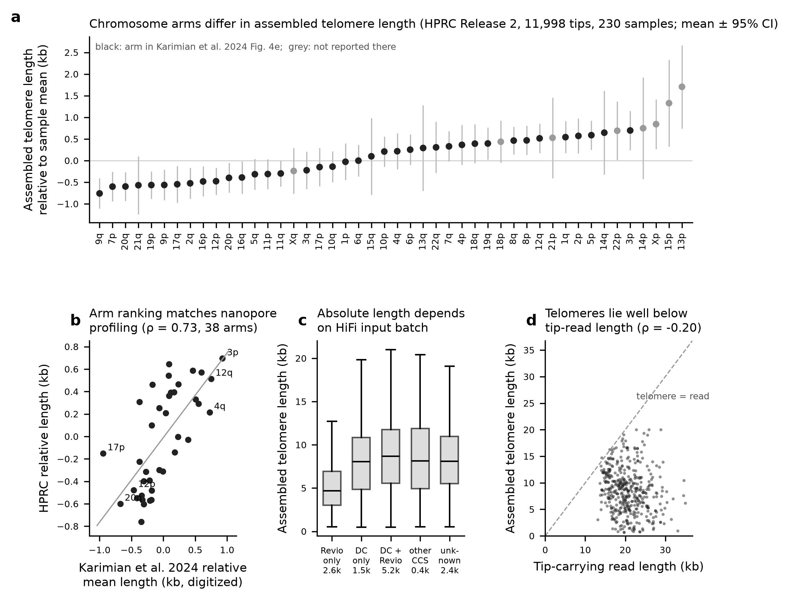
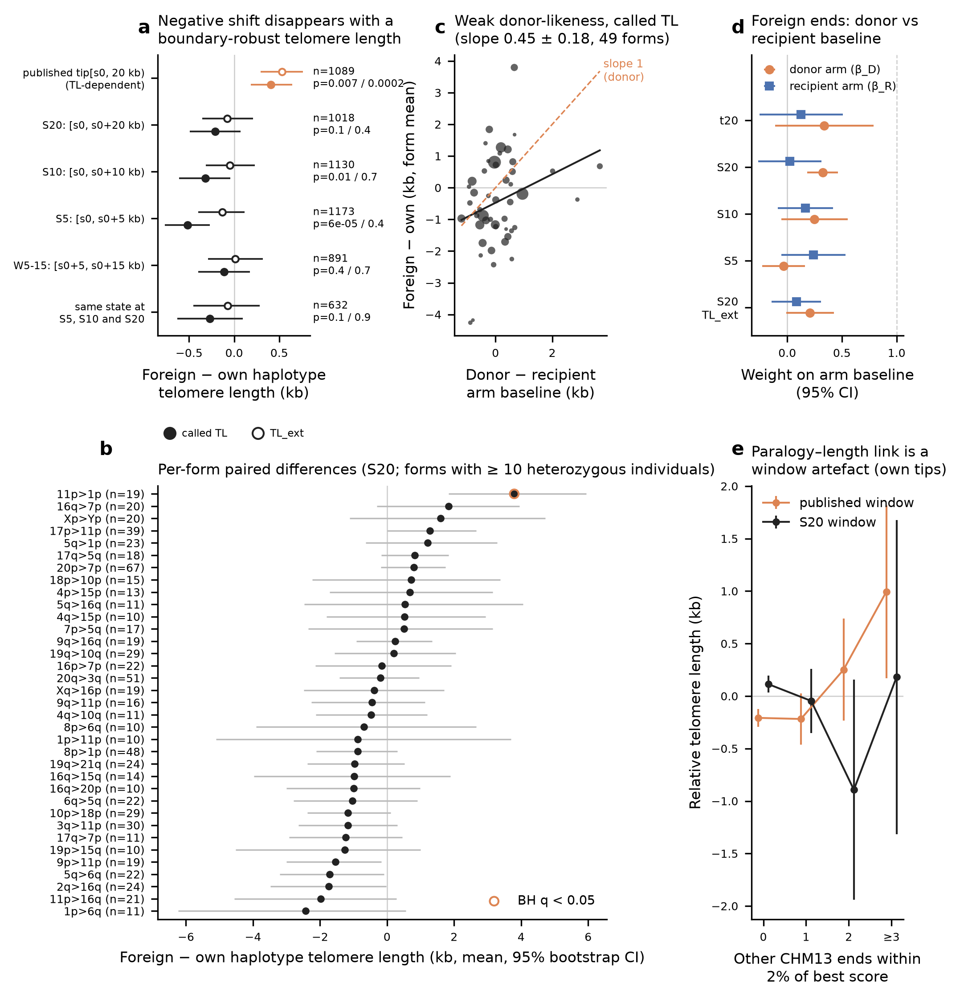
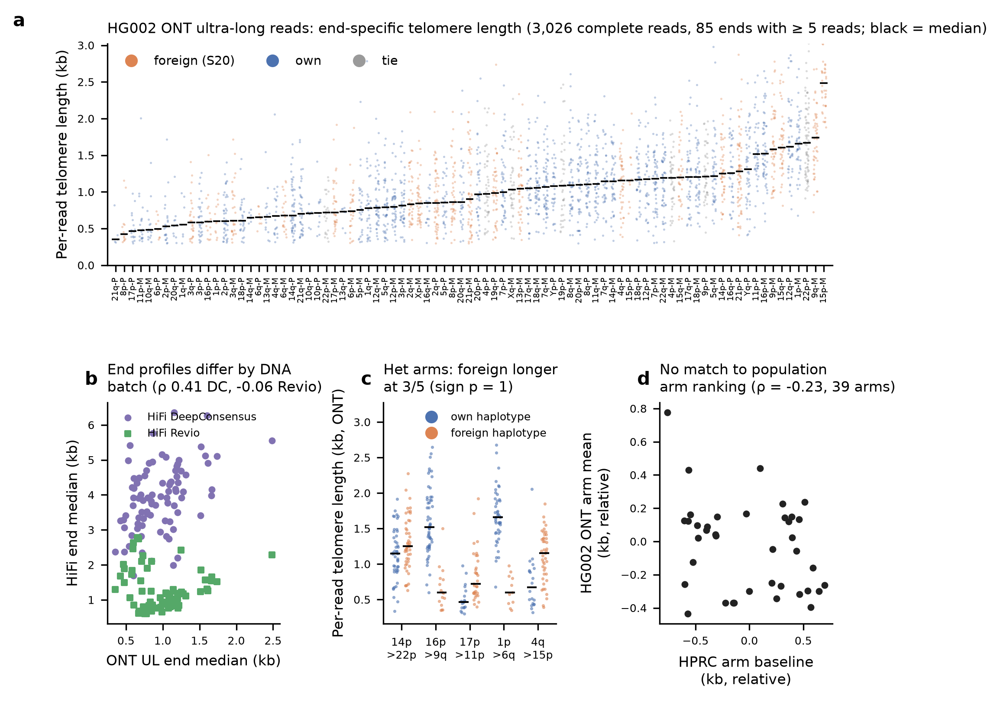

# telomere_cis — is telomere length set in cis by the subtelomere allele? (H1)

This track tests whether the terminal subtelomere allele of a chromosome end, in particular the common "foreign" terminal
blocks (a terminal subtelomere that best matches another CHM13 arm, form `R>D` = recipient arm R carrying a donor-arm-like
block D), determines the length of the adjacent telomere. Data: 11,998 arm-assigned telomeric contig tips from 459 HPRC
Release 2 assemblies (230 samples), and per-read telomere lengths on the 92 ends of the HG002 Q100 v1.1 assembly.

Reproduce: `analyses/telomere_cis/run.sh` (about 30–35 min with 3 threads). Inputs are read from `ATLAS_INPUT_DIR` (set in the
git-ignored `work/config.local.sh`, see `pipeline/config.sh`). The fixed-window step also reads the 100 kb tip windows that
the catalogue pipeline writes to `work/windows/fetch/` (`pipeline/catalogue_02_fetch_windows.sh`). Checksums of every
released file are listed in [MANIFEST.tsv](MANIFEST.tsv). Input checksums, public source URLs and software versions are in
[PROVENANCE.json](PROVENANCE.json).

## Summary of verdicts

| Test | Verdict | Deciding statistic |
|---|---|---|
| Arm-specific telomere length is reproduced in assemblies | **confirmed** | relative assembled length per arm vs Karimian et al. 2024 Fig. 4e: Spearman ρ = 0.73 (38 arms, p = 1.7e-7); split-half ρ = 0.63 (5–95 %: 0.53–0.72) |
| Foreign-form haplotypes have different telomere length (pooled, paired) | **no positive cis effect; small negative raw association explained by telomere-boundary calling** | Called TL under boundary-anchored windows: foreign − own = −211 bp (S20, p = 0.099), −320 bp (S10, p = 0.014), −515 bp (S5, p = 6e-5). The effect is concentrated in calls on the first 5 kb (W5_15, which skips that 5 kb: −110 bp, p = 0.40; S5 − W5_15 = −405 bp, bootstrap p = 0.006). With a boundary-robust length (TL_ext) the estimates are −133 to +14 bp (all p ≥ 0.36); concordant-state pairs give −270 bp raw (p = 0.14) and −70 bp with TL_ext (p = 0.85). Minimum detectable effect about 0.4 kb |
| Published positive association (t20 window) | **artefact** | t20 classifies `tip[s0:20 kb]`, i.e. less subtelomere as the telomere gets longer. With fixed windows the +396 bp effect (p = 0.008) and the +771 bp per paralogous near-arm effect on own-form tips disappear (S20: −85 ± 144 bp) |
| Individual forms | **null; one nominal outlier** | 11p>1p: +3.8 kb, n = 19, BH q = 0.041 with called TL; +3.2 kb, q = 0.099 with TL_ext. 0 of 35 forms at q < 0.05 with TL_ext |
| Donor-likeness (the foreign-form end takes the donor arm's length) | **inconclusive; weak at most** | Called TL, S20: pair slope 0.36 ± 0.15 (p = 0.014, form-permutation p = 0.098). With TL_ext: pair slope 0.16 ± 0.14 (p = 0.28); unpaired β_D 0.21 ± 0.11, β_R 0.08 ± 0.12. Full donor control (slope 1) is rejected with population baselines |
| HG002 read-level validation | **inconclusive (underpowered)** | 5 heterozygous foreign/own arms (S20): foreign longer at 3/5 (sign test p = 1); donor slope 0.48 ± 0.27 (p = 0.17); HiFi Revio disagrees in sign at 2 of 4 arms; the HG002 end profile does not follow the population arm ranking (ρ = −0.23, 39 arms) |

Overall, H1 is not supported. The arm-specific telomere length baseline is real and reproduced. Within individuals, the
subtelomere allele at an arm (foreign vs own terminal block) does not detectably shift the adjacent telomere's length.
* The raw association is small and negative (−0.2 to −0.5 kb) under boundary-anchored allele definitions. It traces to
  the telomere/subtelomere boundary call: interstitial telomeric sequence and degenerate repeats next to the boundary
  shorten the called telomere and also influence the allele call on the first 5 kb.
* With a boundary-robust length, the effect is −0.05 to −0.13 kb and non-significant. There is no positive cis effect.
* A weak donor-associated component cannot be excluded (TL_ext slope 0.16 ± 0.14).

## Methods

### 1. Arm baseline and truncation diagnostics (`scripts/01_baseline.py`)
* Telomere length (TL) = length of the terminal (CCCTAA)n block in tip frame (`pipeline/catalogue_telomere.py`; same
  caller and parameters as the Release 2 tip table). 114 telomeres that reached the 20 kb window edge were re-measured on
  100 kb windows; none remained censored.
* Relative TL = tip TL − mean TL of all named tips of the same sample. This is the deviation from the individual's grand
  mean, as in Karimian et al. 2024. It removes sample-level effects: cell-line history, sequencing batch and read-length
  distribution.
* Truncation and batch diagnostics:
  * TL by HiFi input type and by assembler.
  * Sample mean TL vs coverage-weighted HiFi N50, HiFi coverage and ONT ≥ 100 kb coverage (HPRC sequencing metadata).
  * hifiasm vs year-2 Verkko TL at the same haplotype end.
  * In 10 hifiasm haplotypes with read layouts, the length of the read carrying the contig tip.
* Comparison with published arm-specific lengths: Karimian et al. 2024 (*Science* 384:533–539,
  [doi:10.1126/science.ado0431](https://doi.org/10.1126/science.ado0431); Telomere Profiling, ONT, 147 individuals; Fig. 4e
  reports the mean of each end relative to the individual's grand mean). The paper does not tabulate per-arm values, so
  the 38 arm means were digitized from the Fig. 4e raster of the bioRxiv full text
  ([doi:10.1101/2023.12.21.572870](https://doi.org/10.1101/2023.12.21.572870)) by `scripts/00_karimian_digitize.py`. The
  y axis is calibrated on 4 tick marks (66.8 px/kb, about ±0.02 kb resolution); the rank order comes from the axis labels.
  The derived table is [data/karimian2024_fig4e.tsv](data/karimian2024_fig4e.tsv). The source PDF is not redistributed.

### 2. Telomere-length-independent allele states (`scripts/01b_fixed_window_states.py`)
The published state (t20) classifies `tip[s0, 20 kb)`, where s0 = terminal junk + telomere. The longer the telomere, the
less (and the more terminal, more paralogous) subtelomere is classified. Every named tip was therefore re-classified on
fixed windows anchored at the telomere boundary: S20 = `[s0, s0+20 kb)` (primary; the same amount of sequence as t20),
S10 and S5. The rules are those of the published placement: minimap2 `-x asm20` against the outer 500 kb of the 48 CHM13
v2.0 ends; best alignment score per end over alignments covering ≥ 50 % of the query; own / tie (own ≥ 0.98 × best) /
foreign. A replica of the published query run in the same job reproduces the published t20 state for 99.95 % of the
11,998 tips. S20 calls 4,098 foreign, 7,188 own, 709 tie and 3 none.

### 3. Paired allele test (`scripts/02_paired.py <S20|t20|S10|S5>`)
* Unit: an individual with both haplotype tips of an arm named, one foreign and one own (tie/none excluded).
  d = TL(foreign) − TL(own). Both haplotypes share the sample, assembly run, assembler and HiFi input, so these cancel.
* Tests:
  * Pooled Wilcoxon signed-rank test plus a sign-flip permutation (20,000 draws).
  * Per form with ≥ 10 pairs, Benjamini–Hochberg corrected.
  * Within-arm label shuffle (5,000 permutations of foreign/own labels among all tips of an arm, with the statistic
    recomputed on pairs that are heterozygous after shuffling).
  * Unpaired model over all foreign/own tips: relative TL ~ arm + foreign + haplotype index, with within-arm permutation.
  * Sensitivity analyses: hifiasm only, trio vs Hi-C phasing, no terminal junk, foreign tip with a junction shared by ≥ 2
    samples, haplotype index, HiFi input.
* Donor-likeness: d regressed on x = base(D) − base(R), where base is the mean relative TL of own-form tips of the arm,
  leave-sample-out. Slope 1 means the foreign end takes the donor's length; slope 0 means it keeps the recipient's.
  * Repeated with the external Karimian values, at form level, and as an unpaired regression of every foreign tip on
    base(R) + base(D).
  * Standard errors are cluster-robust by form because tips of one form share x. A form-level permutation permutes x
    among forms.
* Power: the minimum detectable mean difference (80 %, α = 0.05) is 2.80 × SD(d)/√n.

### 3b. Window-artefact checks (`scripts/02b_window_robustness.py`)
* **Boundary QC.** `tail_frac` = fraction of the first 500 bp after the called boundary covered by CCCTAA/TTAGGG units.
  ITS = exact run of ≥ 4 units within [s0+500, s0+5 kb).
* **Graded exclusions:** (i) strict, tail < 0.2 and no ITS; (ii) no premature boundary, tail < 0.5; (iii) no ITS.
* **Pair-level adjustment.** d is regressed on the foreign − own differences in `tail_frac` and ITS bp, with SEs
  cluster-robust by sample.
* **Boundary-robust telomere length, TL_ext.** The boundary is extended while 500 bp windows (step 100 bp) keep ≥ 30 %
  unit coverage (cap 30 kb). TL_ext is then used to recompute d, the arm baseline, donor-likeness and per-form tests.
* **W5_15.** A new allele state on [s0+5 kb, s0+15 kb), which skips the 5 kb next to the telomere. Classification rules
  are as in 01b.
* **Concordant pairs.** Both tips have the same state under S5, S10 and S20; a stricter version also requires W5_15 to agree.
* **Strata.** Paired tests by HiFi input, assembler and phasing, with an inverse-variance combination over strata with
  ≥ 30 pairs and Cochran's Q / I² across strata.
* **Heterogeneity across windows.** Cluster bootstrap over samples (2,000 draws); 95 % intervals of the differences
  between window estimates. The windows share individuals, so a Q test across windows would be invalid.

### 4. HG002 per-read telomere length (`scripts/03_hg002_reads.py`, `scripts/04_hg002_tests.py`)
* Reads: primary winnowmap alignments to the diploid v1.1 assembly (T2T HG002 polishing mapping set) overlapping the outer
  20 kb of each end. Platforms: ONT R10.4.1 UL dorado (primary), PacBio Revio HiFi, and HiFi DeepConsensus as a contrast.
* For each read, the reference telomere/subtelomere boundary is projected into the read through the alignment.
* A read counts as complete when:
  * it is aligned ≥ 5 kb inward of the boundary;
  * its sequence, including soft clips, carries a canonical telomere block starting ≤ 1 kb from the read end on the
    chromosome-end side;
  * it has ≥ 50 % canonical 6-mer coverage and ≥ 300 bp of telomere.
* TL_read = bases from the block start to the boundary. A read broken inside the telomere cannot be told apart from one
  reaching the end, so per-read values are lower bounds.
* Haplotype analyses use MAPQ ≥ 20 and ends with ≥ 5 complete reads.
* HG002 allele states use the same fixed windows (S5/S10/S20) on the outer 40 kb of each v1.1 end, range-read from the
  public FASTA. S20 agrees with the published t20 state at 86 of 92 ends.

## Results

### Arm baseline (Fig. 1)

* Median assembled TL is 7,452 bp; 6.2 % of tips exceed 15 kb.
* Arm explains a small but highly significant share of relative-TL variance: one-way ANOVA over 46 arms with ≥ 40 tips,
  F = 5.32, p = 5e-28, η² = 0.020; per-tip SD of relative TL 3.4 kb.
* The arm ranking agrees with Karimian et al. 2024:
  * Spearman ρ = 0.73 for all tips, Pearson r = 0.69; the HPRC slope is 0.75 kb per Karimian kb.
  * ρ = 0.67 using only S20 own-form tips.
  * ρ = 0.74 for hifiasm only, and 0.47–0.68 within each HiFi input group.
* Karimian's shortest ends rank 3 (20q), 10 (12p) and 17 (17p) of 38 in HPRC; the longest rank 38 (3p), 33 (12q) and 23 (4q).
* Truncation and batch:
  * Absolute TL depends strongly on the HiFi input batch: median 4,687 bp for "Revio only" vs 8,040–8,675 bp for the other
    inputs (Kruskal–Wallis p ≈ 3e-307).
  * Sample mean TL correlates with HiFi coverage (ρ = 0.45) but only weakly with HiFi N50 (ρ = 0.12, p = 0.068; +202 ± 84 bp
    per kb N50 after adjusting for input type).
  * In hifiasm read layouts, the tip-carrying read has a median length of 20.2 kb. Assembled TL is a median 41 % of that
    read's length, is ≥ 80 % of it for 8.2 % of tips, and is negatively correlated with it (ρ = −0.20).
  * Read length therefore does not cap TL for most tips. Because the assembled telomere comes from the furthest-reaching
    read, it behaves like an upper quantile of the cellular length distribution, which explains the coverage dependence.
  * Assembled TL of the same haplotype end in hifiasm (Release 2) and Verkko (year 2) agrees only weakly (ρ = 0.27, 485
    ends). Per-end assembled TL is a noisy measurement; arm means are reliable (split-half ρ = 0.63), single ends are not.

### Allele test (Fig. 2)

* **Primary (S20).** 1,018 heterozygous individuals in 144 forms; mean d = −211 bp (95 % CI −499 to +79).
  * Wilcoxon p = 0.099, sign-flip p = 0.15, within-arm shuffle p = 0.13.
  * Unpaired β_foreign = −157 ± 87 bp (permutation p = 0.079).
  * Minimum detectable mean difference: 408 bp paired, 244 bp unpaired.
* Sensitivity subsets are heterogeneous:
  * Trio-phased −424 bp (p = 0.036) vs Hi-C-phased +65 bp (p = 0.97).
  * Foreign tip with a recurrent junction −560 bp (p = 0.007).
  * Foreign on haplotype 1 −460 bp vs haplotype 2 +19 bp.
* **Window dependence.** Paired mean d is +396 bp (t20, p = 0.008), −211 bp (S20), −320 bp (S10, p = 0.014) and −515 bp
  (S5, p = 6e-5).
  * The positive t20 effect is a classification artefact. Under t20, own-form tips gain +771 ± 96 bp per additional CHM13
    end within 2 % of the best score; under S20 this is −85 ± 144 bp (Fig. 2e).
  * Under the published-window replica, 'none' tips (telomeres filling most of the 20 kb window) are +8,470 ± 233 bp
    (n = 200). With S20, almost no tips are 'none' (n = 3).
  * 'tie' tips (subtelomere nearly equally similar to the own arm and another arm) are +516 ± 132 bp under the replica
    and remain +509 ± 155 bp (n = 709) under S20. This window-independent excess is unexplained. It could be technical
    (ambiguous read anchoring at paralogous ends) or biological, and is reported in `results/robustness_summary.json`.
  * The negative effect under boundary-anchored windows is examined in the next subsection. It is explained by the
    telomere boundary call.
* **Forms.** 1 of 35 S20 forms reaches BH q < 0.05: 11p>1p, +3.8 kb, n = 19. 1 of 33 t20 forms (1q>20p), 0 of 34 S10
  forms and 0 of 29 S5 forms do.
* **Donor-likeness (S20).**
  * Pair-level slope 0.36 ± 0.15 (p = 0.014; form-permutation p = 0.098); form-level slope 0.45 ± 0.18 (49 forms,
    p = 0.018, permutation p = 0.053).
  * Unpaired regression: β_D = 0.32 ± 0.07 and β_R = 0.02 ± 0.15 (203 forms). With Karimian values: pair slope
    0.92 ± 0.46 (p = 0.049), unpaired β_D = 0.96 ± 0.35 and β_R = 0.03 ± 0.24.
  * With t20 and S5 states the slopes are 0.42 ± 0.31 and 0.09 ± 0.25 (both n.s.).
  * Baseline unreliability attenuates slopes. Split-half reliability 0.63 implies full-sample reliability of about 0.77.
* Within-sample repeatability of assembled TL between the two own-form haplotypes of an arm is ρ = 0.41 (2,385 pairs).

#### Window-artefact checks (`results/window_robustness.tsv`, `results/window_robustness.json`)
* **Premature boundaries are common and shorten the called telomere.**
  * 42 % of tips have telomeric units covering ≥ 50 % of the 500 bp after the called boundary, and 51 % carry an ITS in
    the first 5 kb.
  * The 7,851 tips with tail ≥ 0.2 or an ITS have called telomeres 1,109 ± 65 bp shorter (arm-adjusted).
  * TL_ext extends the boundary in 58 % of tips (median extension over all tips 300 bp) and correlates closely with
    called TL (ρ = 0.96).
* **The negative shift comes from the first 5 kb.**
  * W5_15 (skipping that 5 kb): −110 bp (95 % CI −397 to +177, p = 0.40, n = 891).
  * Window differences: S5 − W5_15 = −405 bp (95 % CI −710 to −98, bootstrap p = 0.006); S20 − S5 = +305 bp (p = 0.018);
    S20 − W5_15 = −100 bp (p = 0.40).
  * Under S5, foreign tips carry on average 277 bp more ITS sequence in the first 5 kb than their own-form partners.
  * Each 100 bp of ITS difference lowers the called-TL difference by 123 ± 14 bp.
* **Adjusting for boundary features** gives −116 bp (S20, p = 0.41), −20 bp (S10, p = 0.89), −133 bp (S5, p = 0.29) and
  −62 bp (W5_15, p = 0.68).
* **TL_ext estimates** are −78 bp (S20, p = 0.36), −46 bp (S10, p = 0.73), −133 bp (S5, p = 0.37) and +14 bp (W5_15,
  p = 0.74). The published-window (t20) estimate stays positive (+529 bp, p = 0.0002), as expected for a window-length
  artefact rather than a boundary artefact.
* **Graded exclusions** leave few pairs and wide intervals: strict 90–107 pairs, MDE ≈ 1.2 kb; no premature boundary
  274–353 pairs, S5 −438 bp (p = 0.061), S20 +72 bp.
* **Concordant-state pairs (S5 = S10 = S20).** Combined estimate −270 bp (95 % CI −629 to +94, p = 0.14, n = 632); with
  W5_15 also concordant −275 bp (p = 0.28, n = 481); with TL_ext −70 bp (p = 0.85).
  * Inverse-variance combination over HiFi-input strata: −213 ± 175 bp (p = 0.22, I² = 0).
  * Phasing is heterogeneous (trio −606 bp, p = 0.029, vs Hi-C +143 bp; I² = 0.77).
* **Arm baseline and donor-likeness with TL_ext.**
  * Arm ranking vs Karimian is unchanged (ρ = 0.74).
  * Donor-likeness weakens: pair slope 0.16 ± 0.14 (p = 0.28), unpaired β_D 0.21 ± 0.11 and β_R 0.08 ± 0.12.
  * About half of the called-TL donor-likeness therefore follows the boundary artefact, which is itself sequence-dependent.
  * Per-form tests with TL_ext: 0 of 35 forms at BH q < 0.05 (11p>1p +3.2 kb, nominal p = 0.003, q = 0.099).

**Fig. 2 caption.**
* (a) Paired foreign − own telomere length (mean, 95 % cluster-bootstrap CI) under the published window and four
  boundary-anchored allele definitions, for called TL (filled) and boundary-robust TL_ext (open). The p values on the
  right are Wilcoxon signed-rank tests, called / TL_ext.
* (b) Per-form paired differences (S20, called TL, forms with ≥ 10 heterozygous individuals); the open ring marks BH
  q < 0.05 with called TL.
* (c) Form-level mean difference vs donor-minus-recipient arm baseline (called TL; point size ∝ number of pairs); the
  dashed line is full donor control.
* (d) Weights of the recipient and donor arm baselines in the unpaired model of foreign-form tips (95 % CI,
  cluster-robust by form), with the TL_ext estimate in the bottom row.
* (e) Relative TL of own-form tips by number of paralogous CHM13 ends under the published window and S20.

### HG002 (Fig. 3)

* Complete MAPQ ≥ 20 reads: 3,026 ONT UL (85 ends with ≥ 5 reads), 1,443 Revio (82 ends) and 2,292 HiFi DeepConsensus
  (91 ends).
* Median per-end telomere length differs by DNA batch: 0.90 kb (ONT), 1.15 kb (Revio), 3.92 kb (DeepConsensus).
* Within-platform end profiles are reproducible: ONT split-half ρ = 0.89 with a within-end SD of 387 bp; DeepConsensus 0.78.
* Profiles agree poorly across batches: ONT vs DeepConsensus ρ = 0.41, ONT vs Revio ρ = −0.06. The v1.1 assembly telomeres
  track ONT (ρ = 0.87). The per-end profile of this cell line therefore varies between DNA preparations.
* ONT per-read TL is unrelated to read length (ρ = 0.03; median read 61 kb), so truncation is negligible.
* The HG002 arm profile does not follow the population baseline: ρ = −0.23 vs HPRC, −0.14 vs Karimian.
* Heterozygous foreign/own arms (S20): 14p>22p, 16p>9q, 17p>11p, 1p>6q, 4q>15p.
  * ONT differences: +103, −923, +252, −1,060 and +481 bp (4 of 5 nominal p < 0.05). Their signs follow x at 4 of 5 arms
    (slope 0.48 ± 0.27, p = 0.17).
  * Revio reverses the sign at 17p and 4q.
* Across all 25 HG002 S20-foreign ends with baselines: β_D = 0.01 ± 0.11, β_R = 0.16 ± 0.11.

## Caveats
* HPRC samples are mostly lymphoblastoid cell lines. Cell-line telomeres are shaped by culture history and clonality, and
  the HG002 batch differences show that per-end profiles can shift between preparations. Population-level arm means remain
  concordant with blood and cord-blood data.
* Assembled TL behaves like an upper quantile of the cellular distribution and depends on coverage and HiFi batch. Paired
  within-sample differences remove batch, but per-end measurement noise is large (hifiasm vs Verkko ρ = 0.27). This
  limits power for allele effects below about 400 bp per pair.
* Allele states are window-dependent. S20 is a definition choice; S5/S10 and t20 give different foreign sets and different
  answers. A telomere boundary called too far inward could still shift fixed windows.
* Karimian et al. assigned reads to arms by subtelomere mapping, so foreign-form chromosomes in their cohort would be
  counted under the donor arm. This can inflate apparent donor-likeness against their values.
* Digitized Karimian values carry about ±0.02 kb error; the 26th label (18q) is partly obscured in the source raster.
* The telomere caller (100 bp seed at ≥ 90 %, extension while 200 bp windows stay ≥ 60 % canonical) stops early at
  degenerate repeats in about 40 % of tips. Called TL is therefore a lower bound with sequence-dependent error. TL_ext is
  a heuristic correction and has not been validated against reads.
* HG002 is a single individual with 5 heterozygous arms. 93 ONT reads (4.5 % of reads with boundary not covered) had soft
  clips long enough to possibly reach the chromosome end and were not used.

## Files
* `scripts/` — 00 digitize, 01 baseline, 01b fixed-window states, 02 paired tests, 02b window-artefact checks, 03 HG002 reads, 04 HG002 tests,
  05 figures, 06 manifest; `tl_common.py` holds paths and helpers.
* `results/`:
  * Tables: `tip_telomere_lengths.tsv`, `arm_baseline.tsv`, `arm_own_baseline*.tsv`, `sample_covariates.tsv`,
    `truncation_diagnostics.tsv`, `layout_outer_read.tsv`, `karimian_comparison.tsv`, `fixed_window_states.tsv`,
    `het_pairs*.tsv`, `paired_tests*.tsv`, `paired_by_form*.tsv`, `window_qc.tsv`, `window_robustness.tsv`,
    `paired_by_form_tl_ext.tsv`, `hg002_end_telomere.tsv`, `hg002_ends_summary.tsv`,
    `hg002_fixed_window_states.tsv`, `hg002_het_arms.tsv`.
  * Statistics: `baseline_stats.json`, `paired_stats*.json` (no suffix = S20), `window_robustness.json`, `hg002_stats.json`,
    `robustness_summary.json`.
* `figures/` — fig1–fig3 (PNG + PDF). `data/karimian2024_fig4e.tsv` — digitized published values.
