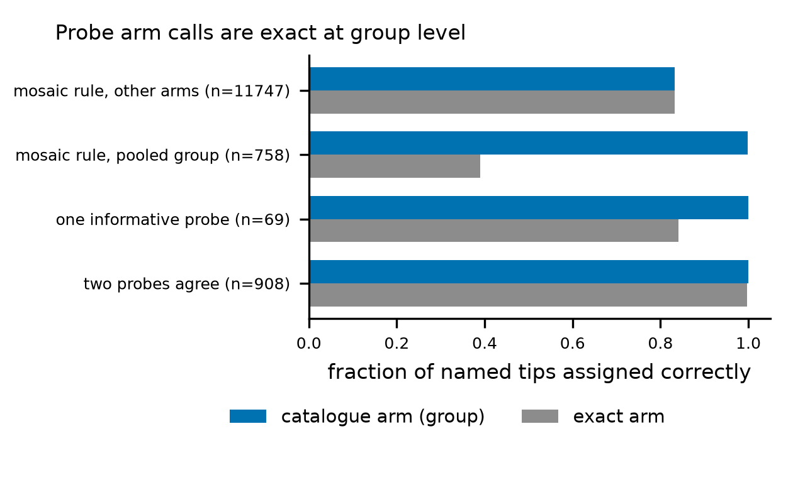
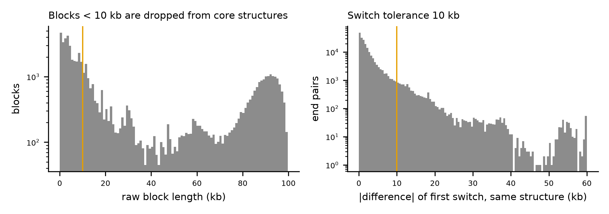
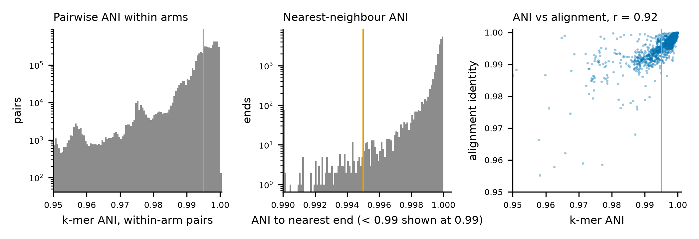
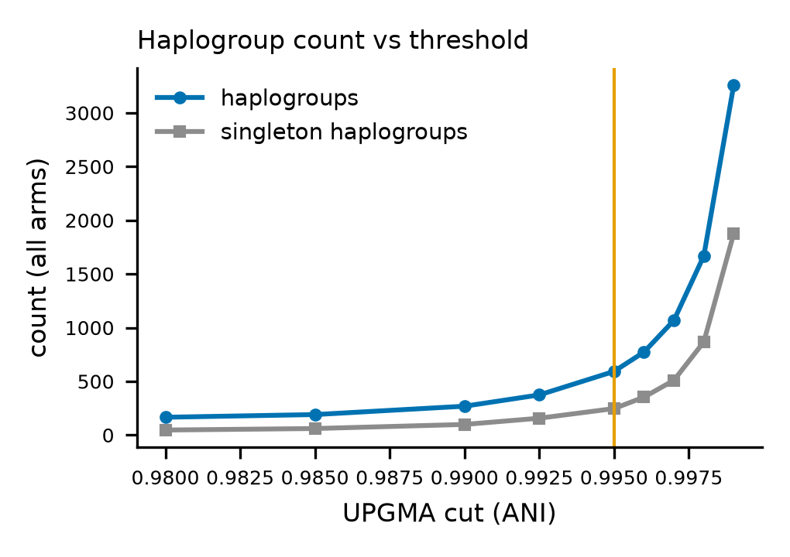

# Allele catalogue v0.1 - QC report

Generated by `pipeline/catalogue_10_qc.py` from the release tables in this directory. All numbers below are computed from those files.

## 1. Inputs and windows

| set | ends | samples | full_100kb | extended | median_telo_len |
|---|---|---|---|---|---|
| CHM13 | 48 | 1 | 48 | 0 | 1943.0 |
| HG002_Q100 | 92 | 1 | 92 | 0 | 1716.0 |
| HPRC_R2 | 20144 | 230 | 19894 | 195 | 7526.5 |
| pedigree_aux | 368 | 4 | 368 | 0 | 5843.5 |

Release 2 windows reused from the earlier 100 kb fetch: 5727; range-read for this release: 14222. Release 2 ends shorter than 100 kb (whole contig used): 250.

## 2. Home-arm assignment

| set | arm_source | arm_confidence | ends |
|---|---|---|---|
| CHM13 | contig_name | named | 48 |
| HG002_Q100 | contig_name | named | 92 |
| HPRC_R2 | contig_name | named | 11998 |
| HPRC_R2 | mosaic | low | 314 |
| HPRC_R2 | mosaic | mosaic_group | 1341 |
| HPRC_R2 | none | none | 3 |
| HPRC_R2 | probe | conflict | 7 |
| HPRC_R2 | probe | high | 5218 |
| HPRC_R2 | probe | medium | 1263 |
| pedigree_aux | contig_name | named | 368 |

Calibration on named Release 2 tips (probe rule: 1,000 random named tips; mosaic rule: all named tips). Group = catalogue arm (acroP = 13p/14p/15p/21p/22p, PAR1 = Xp/Yp, PAR2 = Xq/Yq).

| rule | confidence | n | correct_arm | correct_group | accuracy_arm | accuracy_group |
|---|---|---|---|---|---|---|
| probe | high | 908 | 905 | 908 | 0.9967 | 1.0 |
| probe | medium | 69 | 58 | 69 | 0.8406 | 1.0 |
| probe | any | 977 | 963 | 977 | 0.9857 | 1.0 |
| probe | none_informative | 22 | 0 | 0 | 0.0 | 0.0 |
| mosaic | all_named | 12505 | 10070 | 10532 | 0.8053 | 0.8422 |
| mosaic | named_in_pooled_groups | 761 | 295 | 757 | 0.3876 | 0.9947 |
| mosaic | mosaic_call_in_pooled_group | 758 | 295 | 757 | 0.3892 | 0.9987 |
| mosaic | mosaic_call_other_arms | 11747 | 9775 | 9775 | 0.8321 | 0.8321 |

## 3. Boundary-anchored states and concordance with earlier calls

All catalogue coordinates, blocks and switches are measured from the telomere/subtelomere boundary (s0 = junk_len + telo_len), so structural calls do not depend on telomere length. Per-end states S5/S10/S20 are the majority track label of the first 5/10/20 kb of subtelomere (section 9). A switch (junction) marks where the sequence changes which CHM13 end it most resembles inside shared, paralogous subtelomeric sequence; it is a change in paralog similarity, not necessarily a structural breakpoint.

Foreign fraction among named Release 2 ends (pooled groups count group members as home): S5 0.4977, S10 0.3136, S20 0.2022, t20 0.2918 (n = 11998).

**Primary: S20 vs the telomere_cis fixed-window S20 state** (named ends, non-pooled arms, n = 11316; rows: catalogue, columns: telomere_cis)

| catalogue \ cis | foreign | none | own | tie |
|---|---|---|---|---|
| foreign | 2350 | 1 | 51 | 18 |
| none | 3 | 1 | 1 | 0 |
| own | 767 | 0 | 6811 | 272 |
| tie | 638 | 0 | 116 | 287 |

- S5: state concordance 0.8275 (9364/11316)
- S10: state concordance 0.8121 (9190/11316)
- S20: state concordance 0.8350 (9449/11316)
- S20 foreign in both with the same foreign arm: 1655/3758

**Secondary: t20 (tip[s0:20 kb], telomere-length dependent) vs the earlier t20 calls**

**named ends, non-pooled arms** (rows: this catalogue, columns: earlier call; n = 11316)

| catalogue \ prior | foreign | none | own | tie |
|---|---|---|---|---|
| foreign | 3133 | 25 | 187 | 88 |
| none | 50 | 116 | 24 | 0 |
| own | 662 | 24 | 5890 | 384 |
| tie | 424 | 0 | 104 | 205 |

- state concordance: 0.8257 (9344/11316); earlier-foreign ends called foreign with the same foreign CHM13 end: 2186/4269; t20 form identical: 2186/4269

**named ends, pooled groups (acroP/PAR)** (rows: this catalogue, columns: earlier call; n = 682)

| catalogue \ prior | foreign | none | own | tie |
|---|---|---|---|---|
| foreign | 65 | 1 | 1 | 1 |
| none | 0 | 16 | 13 | 0 |
| own | 246 | 16 | 196 | 113 |
| tie | 14 | 0 | 0 | 0 |

- state concordance: 0.4062 (277/682); earlier-foreign ends called foreign with the same foreign CHM13 end: 50/325; t20 form identical: 50/325

In pooled groups an alignment to another member of the group (e.g. a 21p end matching CHM13 22p) counts as home sequence here, whereas the earlier call scored it foreign; these differences are by design.

Return-to-home switch (first home block after a foreign block; boundary coordinates) vs the earlier `switch_final` converted to boundary coordinates for 3220 named foreign ends with both: identical 461, within 1 kb 842, within 5 kb 2483, median |difference| 2386 bp. Differences arise mainly from isolated tie bins inside a foreign run, which the catalogue smooths into the run (the earlier call ended the run at the first tie bin).

## 4. Mosaic blocks and structural-allele thresholds

Structural alleles are defined on core blocks (raw blocks >= MIN_BLOCK) in boundary coordinates; switch positions of members agree within the switch tolerance (complete linkage, Chebyshev distance).

Raw blocks: 58172 over 20652 ends; base-level switch refinement for 28562 of 37520 switches. Core blocks (blocks < 10000 bp dropped): 29973.

Pairs of full-length defining ends with the same core structure: 199578; first-switch difference <= 1 kb: 80335 (0.403), <= 10000 bp: 188729 (0.946).

Structural allele count vs switch tolerance (same definition set):

| switch_tolerance_bp | structural_alleles |
|---|---|
| 2000 | 1097 |
| 5000 | 770 |
| 10000 | 647 |
| 20000 | 594 |

## 5. Haplogroup threshold

Within-arm pairs: 5956546; fraction of pairs with ANI >= 0.995: 0.5746. Ends whose nearest neighbour in the arm is >= 0.995: 0.9904 of 19919. k-mer ANI vs alignment identity on 1812 random within-arm pairs: Pearson r = 0.920; median alignment identity of pairs with ANI >= 0.995: 0.99816 (n = 1124), below: 0.99084.

| threshold | groups | singletons | ends | mean_group_size |
|---|---|---|---|---|
| 0.98 | 166 | 47 | 19919 | 119.99 |
| 0.985 | 191 | 61 | 19919 | 104.29 |
| 0.99 | 269 | 99 | 19919 | 74.05 |
| 0.9925 | 374 | 157 | 19919 | 53.26 |
| 0.995 | 593 | 247 | 19919 | 33.59 |
| 0.996 | 773 | 353 | 19919 | 25.77 |
| 0.997 | 1068 | 510 | 19919 | 18.65 |
| 0.998 | 1668 | 867 | 19919 | 11.94 |
| 0.999 | 3257 | 1875 | 19919 | 6.12 |

Member-to-medoid validation by alignment (mappy asm20): median identity 0.99870; members with identity < 0.99: 164; aligned fraction < 0.8: 22 of 20617.

## 6. Catalogue per arm

| arm | r2_ends | r2_samples | structural_alleles | sa_tierA | sa_tierB | sa_tierC | native_freq | haplogroups | hg_nonsingleton | sa_unassigned | hg_unassigned |
|---|---|---|---|---|---|---|---|---|---|---|---|
| 10p | 433 | 228 | 3 | 1 | 1 | 1 | 0.9885 | 3 | 2 | 0 | 0 |
| 10q | 447 | 229 | 11 | 3 | 3 | 5 | 0.9054 | 34 | 14 | 3 | 3 |
| 11p | 447 | 229 | 47 | 9 | 13 | 25 | 0.3632 | 20 | 17 | 1 | 1 |
| 11q | 441 | 230 | 1 | 1 | 0 | 0 | 1.0 | 1 | 1 | 0 | 0 |
| 12p | 443 | 230 | 5 | 1 | 3 | 1 | 0.9571 | 2 | 2 | 0 | 0 |
| 12q | 445 | 229 | 2 | 1 | 0 | 1 | 0.9978 | 5 | 2 | 0 | 0 |
| 13q | 442 | 228 | 3 | 1 | 0 | 2 | 0.9932 | 3 | 2 | 0 | 0 |
| 14q | 439 | 229 | 3 | 1 | 1 | 1 | 0.9909 | 2 | 1 | 0 | 0 |
| 15q | 440 | 229 | 35 | 4 | 12 | 19 | 0.4182 | 16 | 10 | 0 | 0 |
| 16p | 431 | 230 | 49 | 5 | 7 | 37 | 0.7169 | 18 | 16 | 0 | 0 |
| 16q | 439 | 227 | 47 | 5 | 10 | 32 | 0.4465 | 24 | 16 | 0 | 0 |
| 17p | 441 | 228 | 17 | 5 | 2 | 10 | 0.4626 | 16 | 12 | 0 | 0 |
| 17q | 448 | 229 | 15 | 5 | 7 | 3 | 0.1477 | 7 | 6 | 1 | 1 |
| 18p | 436 | 229 | 2 | 1 | 1 | 0 | 0.9839 | 4 | 4 | 0 | 0 |
| 18q | 446 | 230 | 1 | 1 | 0 | 0 | 1.0 | 1 | 1 | 1 | 1 |
| 19p | 441 | 229 | 39 | 6 | 16 | 17 | 0.1071 | 17 | 10 | 2 | 0 |
| 19q | 448 | 230 | 12 | 4 | 2 | 6 | 0.8058 | 2 | 2 | 0 | 0 |
| 1p | 436 | 228 | 25 | 5 | 6 | 14 | 0.1218 | 24 | 12 | 1 | 1 |
| 1q | 439 | 230 | 2 | 1 | 0 | 1 | 0.9977 | 3 | 2 | 0 | 0 |
| 20p | 444 | 230 | 21 | 5 | 8 | 8 | 0.4527 | 10 | 7 | 0 | 0 |
| 20q | 440 | 226 | 13 | 2 | 6 | 5 | 0.4579 | 9 | 8 | 1 | 0 |
| 21q | 442 | 227 | 4 | 1 | 1 | 2 | 0.9751 | 2 | 1 | 0 | 0 |
| 22q | 441 | 229 | 7 | 1 | 0 | 6 | 0.9819 | 3 | 1 | 0 | 0 |
| 2p | 438 | 229 | 2 | 1 | 0 | 1 | 0.9977 | 2 | 1 | 0 | 0 |
| 2q | 442 | 229 | 20 | 5 | 6 | 9 | 0.6644 | 10 | 7 | 1 | 1 |
| 3p | 443 | 230 | 1 | 1 | 0 | 0 | 1.0 | 1 | 1 | 0 | 0 |
| 3q | 435 | 228 | 27 | 4 | 8 | 15 | 0.1244 | 16 | 5 | 1 | 0 |
| 4p | 446 | 229 | 4 | 1 | 2 | 1 | 0.8629 | 5 | 2 | 1 | 3 |
| 4q | 426 | 222 | 16 | 2 | 4 | 10 | 0.4437 | 33 | 14 | 0 | 1 |
| 5p | 448 | 230 | 3 | 1 | 0 | 2 | 0.9955 | 4 | 4 | 0 | 0 |
| 5q | 440 | 230 | 28 | 6 | 4 | 18 | 0.4909 | 23 | 14 | 0 | 0 |
| 6p | 439 | 230 | 26 | 6 | 8 | 12 | 0.0683 | 24 | 15 | 0 | 0 |
| 6q | 433 | 229 | 32 | 9 | 9 | 14 | 0.4781 | 25 | 15 | 0 | 0 |
| 7p | 451 | 227 | 23 | 3 | 3 | 17 | 0.8065 | 16 | 8 | 17 | 17 |
| 7q | 442 | 228 | 1 | 1 | 0 | 0 | 1.0 | 4 | 3 | 0 | 0 |
| 8p | 450 | 230 | 15 | 3 | 3 | 9 | 0.3163 | 18 | 10 | 1 | 0 |
| 8q | 445 | 229 | 4 | 1 | 1 | 2 | 0.9887 | 6 | 3 | 1 | 0 |
| 9p | 436 | 229 | 16 | 4 | 4 | 8 | 0.4243 | 15 | 8 | 0 | 0 |
| 9q | 449 | 230 | 46 | 8 | 9 | 29 | 0.2873 | 23 | 14 | 0 | 0 |
| PAR1 | 439 | 228 | 3 | 1 | 1 | 1 | 0.9795 | 78 | 46 | 0 | 0 |
| PAR2 | 441 | 230 | 5 | 2 | 2 | 1 | 0.8798 | 4 | 2 | 0 | 0 |
| acroP | 2049 | 230 | 11 | 1 | 3 | 7 | 0.9624 | 60 | 26 | 1 | 1 |
| unassigned | 3 | 3 | 0 | 0 | 0 | 0 |  | 0 | 0 | 3 | 3 |

## 7. Validation tiers

| tier | is_native | alleles | r2_ends |
|---|---|---|---|
| A | False | 90 | 3892 |
| A | True | 39 | 14080 |
| B | False | 163 | 1441 |
| B | True | 3 | 268 |
| C | False | 352 | 427 |

| tier | haplogroups | r2_ends |
|---|---|---|
| A | 131 | 18148 |
| B | 152 | 1586 |
| C | 310 | 377 |

Assignment of ends to structural alleles / haplogroups:

| set | sa_assignment | ends |
|---|---|---|
| CHM13 | full | 48 |
| HG002_Q100 | full | 92 |
| HPRC_R2 | arm_lowconf | 100 |
| HPRC_R2 | full | 19767 |
| HPRC_R2 | partial_ambiguous | 197 |
| HPRC_R2 | partial_unique | 44 |
| HPRC_R2 | unassigned_arm_lowconf | 27 |
| HPRC_R2 | unassigned_partial | 9 |
| pedigree_aux | aux | 363 |
| pedigree_aux | unassigned_aux | 5 |

| set | hg_assignment | ends |
|---|---|---|
| CHM13 | full | 48 |
| HG002_Q100 | full | 92 |
| HPRC_R2 | arm_lowconf | 143 |
| HPRC_R2 | full | 19779 |
| HPRC_R2 | partial | 189 |
| HPRC_R2 | unassigned_arm_lowconf | 23 |
| HPRC_R2 | unassigned_partial | 7 |
| HPRC_R2 |  | 3 |
| pedigree_aux | aux | 366 |
| pedigree_aux | unassigned_aux | 2 |

Flags (ends may carry several):

| flag | ends |
|---|---|
| arm_inferred | 8146 |
| complex_structure | 1240 |
| short_telomere | 317 |
| arm_low_confidence | 314 |
| junk_gt_1kb | 305 |
| dup_arm_in_haplotype | 303 |
| partial_window | 250 |
| window_extended | 195 |
| junk_chimeric | 27 |
| vk_discordant | 25 |
| layout_mismatch | 8 |
| arm_conflict | 7 |
| artefact_candidate | 4 |
| one_read_zone | 2 |

Artefact candidates named in the build brief:

| end_id | catalogue_arm | core_structure | structural_allele_id | sa_assignment | haplogroup_id | vk_status | lay_status |
|---|---|---|---|---|---|---|---|
| HG02647#1#CM086565.1#R | 16q | PF02 | SA-16q-43 | full | HG-16q-21 | concordant | not_tested |
| HG03486#1#CM091971.1#R | 8q | PF02|2q|PF02|8p |  | unassigned_partial | HG-8q-05 | not_tested | not_tested |
| HG03710#1#CM086867.1#L | 4p | home | SA-4p-01 | full | HG-4p-01 | discordant | not_tested |
| HG04228#2#CM088508.1#L | 6p | 17q|PF02 | SA-6p-120 | full | HG-6p-24 | concordant | not_tested |

Evidence counts: ends Verkko-concordant = 469, Verkko-discordant = 25, layout-supported = 63, HG002 Q100 read-supported switches = 21, pedigree intact child ends = 134, pedigree not intact = 50.

## 8. Allele tie-break and boundary sensitivity

Ends with several compatible structural alleles are assigned to the allele with the nearest median switch positions, then the most defining ends (shared function `subtel_atlas.alleles.match_allele`, also used by the query tool). Re-assigning every defining end as if it were not defining returns its own allele for 0.9983 (19873/19907) with this rule vs 0.9874 (19657/19907) with the previous most-frequent-first rule, which absorbed ends of same-structure alleles < 10 kb apart into the larger one. Among the 704 assigned non-defining ends (partial, low-confidence arm, pedigree), 13 change allele.

## 9. Track-based mosaic: paralog families and boundary-shift stability

Method (atlas/subtel_atlas/tracks.py): one alignment pass per end (subtelomere vs the 48 CHM13 500 kb ends, minimap2 -x asm20 -c --cs=short --secondary=yes -N 200 -p 0.01); per-base match tracks per CHM13 end; sliding 5 kb identity on a 100 bp grid anchored at the contig tip (independent of where the boundary is called); grid labels = home if a home end is within 0.5 percentage points of the best identity, else the paralog family of the best end, none below 0.8; runs < 2 kb merged; boundaries refined at base level on the label tracks. S5/S10/S20 states are the majority grid label of the window.

Paralog families (`paralog_families.tsv`): connected components of CHM13 ends co-tied (within the margin, sampled every 1 kb over all defining ends) at >= 200 points and in >= 0.75 of the points where the rarer end is tied:

| family | n_members | members | n_edges | min_cotie_rate | median_cotie_rate | tied_points |
|---|---|---|---|---|---|---|
| PF01 | 5 | 4p,14p,15p,21p,22p | 7 | 0.8257 | 0.8516 | 705433 |
| PF02 | 3 | 1p,5q,6q | 3 | 0.8168 | 0.8218 | 519915 |
| PF03 | 2 | 11p,15q | 1 | 0.8916 | 0.8916 | 260630 |
| PF04 | 2 | 3q,19p | 1 | 0.8077 | 0.8077 | 322601 |
| PF05 | 2 | Xp,Yp | 1 | 0.9177 | 0.9177 | 68591 |
| PF06 | 2 | Xq,Yq | 1 | 0.9896 | 0.9896 | 83431 |

Acceptance test (`catalogue_12_stability_*.py`): 1043 Release 2 ends (seeded; stratified by previous tier x nativity x arm class; duplicon-rich arms 6p, 8p, 9q, 11p, 15q, 16p, 16q, 19p), every window re-aligned from shifted boundaries s0 + d; calls at d compared with d = 0. Wilson 95% intervals. Nativity = the allele the end receives at d = 0 in this build. Full table (all strata, counts, intervals): `data/catalogue/qc/stability_summary.tsv`; family-threshold scan: `data/catalogue/qc/stability_tau_scan.tsv`.

| shift | group | n | allele | structure | S20 |
|---|---|---|---|---|---|
| -1000 | all | 1043 | 0.927 (0.9097-0.9414) | 0.929 (0.9118-0.9431) | 0.941 (0.9245-0.9534) |
| -500 | all | 1043 | 0.967 (0.9548-0.9766) | 0.968 (0.9559-0.9774) | 0.970 (0.9581-0.979) |
| -100 | all | 1043 | 0.992 (0.9849-0.9961) | 0.992 (0.9849-0.9961) | 0.982 (0.9717-0.9883) |
| 100 | all | 1043 | 0.993 (0.9862-0.9967) | 0.994 (0.9875-0.9974) | 0.985 (0.9752-0.9905) |
| 500 | all | 1043 | 0.963 (0.9493-0.9725) | 0.966 (0.9537-0.9758) | 0.966 (0.9537-0.9758) |
| 1000 | all | 1043 | 0.940 (0.9235-0.9525) | 0.946 (0.9309-0.9584) | 0.943 (0.9267-0.955) |
| -1000 | duplicon_rich | 550 | 0.914 (0.8882-0.9351) | 0.914 (0.8882-0.9351) | 0.953 (0.9316-0.9675) |
| -500 | duplicon_rich | 550 | 0.960 (0.9402-0.9734) | 0.960 (0.9402-0.9734) | 0.980 (0.9645-0.9888) |
| -100 | duplicon_rich | 550 | 0.996 (0.9868-0.999) | 0.996 (0.9868-0.999) | 0.991 (0.9789-0.9961) |
| 100 | duplicon_rich | 550 | 0.996 (0.9868-0.999) | 0.996 (0.9868-0.999) | 0.991 (0.9789-0.9961) |
| 500 | duplicon_rich | 550 | 0.960 (0.9402-0.9734) | 0.960 (0.9402-0.9734) | 0.984 (0.9692-0.9914) |
| 1000 | duplicon_rich | 550 | 0.947 (0.9253-0.963) | 0.947 (0.9253-0.963) | 0.973 (0.9555-0.9834) |
| -1000 | native | 394 | 0.952 (0.9259-0.9689) | 0.952 (0.9259-0.9689) | 0.985 (0.9672-0.993) |
| -500 | native | 394 | 0.977 (0.9572-0.9879) | 0.977 (0.9572-0.9879) | 0.995 (0.9817-0.9986) |
| -100 | native | 394 | 0.992 (0.9779-0.9974) | 0.992 (0.9779-0.9974) | 0.995 (0.9817-0.9986) |
| 100 | native | 394 | 1.000 (0.9903-1.0) | 1.000 (0.9903-1.0) | 1.000 (0.9903-1.0) |
| 500 | native | 394 | 0.990 (0.9742-0.996) | 0.990 (0.9742-0.996) | 0.985 (0.9672-0.993) |
| 1000 | native | 394 | 0.995 (0.9817-0.9986) | 0.995 (0.9817-0.9986) | 0.987 (0.9706-0.9946) |
| -1000 | non-native | 649 | 0.912 (0.8879-0.9316) | 0.915 (0.8913-0.9343) | 0.914 (0.8896-0.933) |
| -500 | non-native | 649 | 0.962 (0.9438-0.9738) | 0.963 (0.9456-0.975) | 0.955 (0.9366-0.9687) |
| -100 | non-native | 649 | 0.992 (0.9821-0.9967) | 0.992 (0.9821-0.9967) | 0.974 (0.9585-0.9836) |
| 100 | non-native | 649 | 0.989 (0.9779-0.9948) | 0.991 (0.98-0.9958) | 0.975 (0.9603-0.9848) |
| 500 | non-native | 649 | 0.946 (0.9259-0.961) | 0.952 (0.933-0.9661) | 0.955 (0.9366-0.9687) |
| 1000 | non-native | 649 | 0.906 (0.8811-0.9261) | 0.917 (0.893-0.9357) | 0.915 (0.8913-0.9343) |
| -1000 | other | 493 | 0.941 (0.9168-0.9587) | 0.945 (0.9215-0.9621) | 0.927 (0.9006-0.9468) |
| -500 | other | 493 | 0.976 (0.9579-0.986) | 0.978 (0.9605-0.9875) | 0.959 (0.9382-0.9736) |
| -100 | other | 493 | 0.988 (0.9737-0.9944) | 0.988 (0.9737-0.9944) | 0.972 (0.9529-0.983) |
| 100 | other | 493 | 0.990 (0.9765-0.9957) | 0.992 (0.9793-0.9968) | 0.978 (0.9605-0.9875) |
| 500 | other | 493 | 0.966 (0.9455-0.9784) | 0.974 (0.9554-0.9845) | 0.947 (0.9238-0.9638) |
| 1000 | other | 493 | 0.931 (0.9052-0.9502) | 0.945 (0.9215-0.9621) | 0.909 (0.88-0.9311) |
| -1000 | tier A | 440 | 0.939 (0.9122-0.9575) | 0.941 (0.9148-0.9594) | 0.943 (0.9175-0.9612) |
| -500 | tier A | 440 | 0.973 (0.9529-0.9843) | 0.975 (0.9558-0.986) | 0.977 (0.9587-0.9876) |
| -100 | tier A | 440 | 0.996 (0.9836-0.9988) | 0.996 (0.9836-0.9988) | 0.984 (0.9675-0.9923) |
| 100 | tier A | 440 | 0.993 (0.9801-0.9977) | 0.993 (0.9801-0.9977) | 0.984 (0.9675-0.9923) |
| 500 | tier A | 440 | 0.975 (0.9558-0.986) | 0.977 (0.9587-0.9876) | 0.971 (0.9501-0.9827) |
| 1000 | tier A | 440 | 0.955 (0.9308-0.9704) | 0.961 (0.939-0.9757) | 0.946 (0.9201-0.9631) |
| -1000 | tier B | 383 | 0.914 (0.8815-0.938) | 0.914 (0.8815-0.938) | 0.943 (0.9146-0.9618) |
| -500 | tier B | 383 | 0.956 (0.9301-0.9721) | 0.956 (0.9301-0.9721) | 0.974 (0.9526-0.9858) |
| -100 | tier B | 383 | 0.990 (0.9735-0.9959) | 0.990 (0.9735-0.9959) | 0.987 (0.9698-0.9944) |
| 100 | tier B | 383 | 0.992 (0.9772-0.9973) | 0.995 (0.9812-0.9986) | 0.987 (0.9698-0.9944) |
| 500 | tier B | 383 | 0.953 (0.9269-0.9701) | 0.961 (0.9364-0.9761) | 0.977 (0.9559-0.9876) |
| 1000 | tier B | 383 | 0.929 (0.8994-0.9511) | 0.940 (0.9115-0.9597) | 0.956 (0.9301-0.9721) |
| -1000 | tier C | 220 | 0.927 (0.8851-0.9547) | 0.932 (0.8906-0.9582) | 0.932 (0.8906-0.9582) |
| -500 | tier C | 220 | 0.977 (0.9479-0.9903) | 0.977 (0.9479-0.9903) | 0.950 (0.9127-0.9719) |
| -100 | tier C | 220 | 0.991 (0.9675-0.9975) | 0.991 (0.9675-0.9975) | 0.968 (0.9358-0.9845) |
| 100 | tier C | 220 | 0.996 (0.9747-0.9992) | 0.996 (0.9747-0.9992) | 0.982 (0.9542-0.9929) |
| 500 | tier C | 220 | 0.955 (0.9184-0.9751) | 0.955 (0.9184-0.9751) | 0.941 (0.9015-0.9651) |
| 1000 | tier C | 220 | 0.927 (0.8851-0.9547) | 0.927 (0.8851-0.9547) | 0.914 (0.8691-0.944) |

Targets at +/-500 bp: non-native allele stability >= 0.90 -> 0.946-0.962; native >= 0.97 -> 0.977-0.990.

Previous (5 kb-bin) method on its 600-end subset, allele unchanged at both -500 and +500 bp: native 0.960 (n = 448), non-native 0.401 (n = 152). Track method, same 'both shifts' criterion on the 1043-end subset: native 0.975 (n = 394), non-native 0.920 (n = 649).

Family threshold scan (core-structure stability at +/-500 bp; tau = 1.01 means no families; all shifts in `data/catalogue/qc/stability_tau_scan.tsv`):

| tau | n_families | largest | non-native -500 | non-native +500 | native -500 | native +500 |
|---|---|---|---|---|---|---|
| 0.4 | 7 | 5 | 0.973 | 0.941 | 0.982 | 0.99 |
| 0.5 | 6 | 5 | 0.952 | 0.933 | 0.982 | 0.99 |
| 0.6 | 6 | 5 | 0.952 | 0.939 | 0.982 | 0.99 |
| 0.75 | 6 | 5 | 0.962 | 0.952 | 0.979 | 0.992 |
| 0.9 | 3 | 3 | 0.947 | 0.936 | 0.995 | 1.0 |
| 1.01 | 0 | 1 | 0.946 | 0.936 | 0.995 | 1.0 |

Allele-level stability by tau (alleles defined from the catalogue labelled with that tau; fixed windows from identity means in this scan):

| tau | structural_alleles | non-native -500 | native -500 | non-native +500 | native +500 |
|---|---|---|---|---|---|
| 0.4 | 506 | 0.966 | 0.9809 | 0.932 | 0.9918 |
| 0.5 | 514 | 0.9521 | 0.9787 | 0.9266 | 0.992 |
| 0.75 | 647 | 0.9615 | 0.9772 | 0.9461 | 0.9898 |
| 1.01 | 838 | 0.9444 | 0.9861 | 0.9314 | 0.993 |

Alternative design (consensus of the 5 kb-bin labels over tiling offsets 0-4 kb, same families) vs the track method, core-structure stability on a seeded 300-end subsample (previous nativity):

| method | shift | n | all | non_native | native |
|---|---|---|---|---|---|
| bins, consensus over 5 offsets | -500 | 300 | 0.853 | 0.789 | 0.964 |
| tracks | -500 | 300 | 0.97 | 0.953 | 1.0 |
| bins, consensus over 5 offsets | 500 | 300 | 0.85 | 0.784 | 0.964 |
| tracks | 500 | 300 | 0.95 | 0.921 | 1.0 |

Per-end flag `boundary_stable_allele` (track shift without re-alignment, tracks.shift_tracks) agrees with the re-aligned result for 0.9789 of the 1043 subset ends. Release 2 ends flagged stable: allele 0.9711, S20 0.9727, both 0.9480.

Same-haplotype cross-check (data/validation; 10994 primary pairs of a catalogue end and the independent Tan et al. 2026 record of the same sample, haplotype and arm, re-classified with the track method and the same clipping and assignment rules): structural-allele agreement 0.9636 (previous method: 0.9364), core structure 0.9629, S20 0.9778; by boundary difference: exact 0.982, 1-100 bp 0.979, 101 bp-1 kb 0.959, >1 kb 0.875.

External cross-check before the redesign (data/validation/README.md): boundary identical in 35.7% of pairs and within 100 bp in 76.7%; structural-allele agreement 98.8% with identical boundaries, 96.6% for 1-100 bp, 89.8% for 101 bp-1 kb and 73.4% for > 1 kb differences.

## 10. Paralog families, the home rule, nativity classes and none blocks

Plain-language definitions. At every 100 bp point of an end's subtelomere, the identity of the surrounding 5 kb to each of the 48 CHM13 v2.0 ends is read from one alignment of the whole window. (1) Home rule: the point is labelled home if a CHM13 copy of the end's own arm (or of an arm of its pooled group: acroP, PAR1, PAR2) is within 0.5 percentage points of the best identity; home therefore wins ties. (2) Paralog families: some CHM13 ends share long, near-identical duplicated blocks, so the best end at a point can flip between them with small sequence or boundary changes. Two CHM13 ends are put in one family when, over all defining catalogue ends, they are tied with each other (both within the margin of the best) at >= 0.75 of the points where the less often tied of the two is tied (and at >= 200 points); families are the connected groups of such pairs (`paralog_families.tsv`). A point that is not home is labelled with the family of its best end (PF01...), or with that end's arm if it belongs to no family. The family is a property of the CHM13 ends across the catalogue, not of the individual block: inside a given block the other members may or may not be tied (column `mean_tied` of `mosaic_blocks.tsv`; the single best CHM13 end of each block is kept in `best_end` and of each fixed window in `S*_best_end`). (3) none: the best identity to every CHM13 end is < 0.80 at that point, i.e. sequence without a close CHM13 counterpart (for example sequence absent from CHM13, or diverged beyond 20%); it is neither home nor foreign evidence. After merging blocks < 10 kb into their neighbours, a none block in a core structure is >= 10 kb of such sequence; switches next to a none block are kept at grid resolution.

Worked example: HG02129#2#CM085868.1#R (catalogue arm 20q, allele SA-20q-01; one of the query-tool test windows in `tests/fixtures/windows.fa.gz`). Its outer 31,040 bp of subtelomere best match CHM13 3q. In the previous build its form was `20q>3q`; it is now `20q>PF04` (core structure `PF04|home`), because CHM13 3q and 19p form family PF04 (co-tied at 0.81 of the points where the less often tied of the two is tied, over the catalogue). `S20_best_end` keeps `chr3q`. Over this block the end matches CHM13 3q at a median 99.92%, 19p at 98.34% and its own arm 20q at 98.36% (19p within the 0.5-point margin of 3q at 0% of 311 points): the block is specifically 3q-like, and the family label records only that 3q belongs to a pair of CHM13 ends that are often interchangeable elsewhere in the catalogue.

Nativity class (`nativity_class` in ends.tsv and alleles_structural.tsv; shared function `subtel_atlas.tracks.nativity_class`, also in the query tool), from the core structure: native = only home (and none) blocks; within_family = non-home blocks, all labelled with a family that contains the own arm (or a member of its pooled group), i.e. sequence closer to another member's CHM13 copy of a shared family block than to the own-arm copy; foreign = at least one block labelled with a family or CHM13 arm that does not contain the own arm. `is_native` (structure exactly `home`) is kept.

| table | n | native | within_family | foreign |
|---|---|---|---|---|
| Release 2 ends | 20144 | 14461 | 747 | 4936 |
| all catalogue ends | 20652 | 14827 | 771 | 5054 |
| structural alleles | 647 | 67 | 49 | 531 |
| structural alleles with is_native | 42 | 42 | 0 | 0 |

Native-class alleles that are not `is_native` contain none blocks only besides home (e.g. `home|none|home`). Per catalogue arm, Release 2 ends:

| catalogue_arm | n | native | within_family | foreign | foreign_frac |
|---|---|---|---|---|---|
| 10p | 433 | 428 | 0 | 5 | 0.012 |
| 10q | 447 | 404 | 0 | 43 | 0.096 |
| 11p | 447 | 162 | 3 | 282 | 0.631 |
| 11q | 441 | 441 | 0 | 0 | 0.0 |
| 12p | 443 | 424 | 0 | 19 | 0.043 |
| 12q | 445 | 444 | 0 | 1 | 0.002 |
| 13q | 442 | 439 | 0 | 3 | 0.007 |
| 14q | 439 | 439 | 0 | 0 | 0.0 |
| 15q | 440 | 184 | 44 | 212 | 0.482 |
| 16p | 431 | 309 | 0 | 122 | 0.283 |
| 16q | 439 | 197 | 0 | 242 | 0.551 |
| 17p | 441 | 208 | 0 | 233 | 0.528 |
| 17q | 448 | 72 | 0 | 376 | 0.839 |
| 18p | 436 | 429 | 0 | 7 | 0.016 |
| 18q | 446 | 445 | 0 | 1 | 0.002 |
| 19p | 441 | 47 | 6 | 388 | 0.88 |
| 19q | 448 | 362 | 0 | 86 | 0.192 |
| 1p | 436 | 53 | 296 | 87 | 0.2 |
| 1q | 439 | 438 | 0 | 1 | 0.002 |
| 20p | 444 | 201 | 0 | 243 | 0.547 |
| 20q | 440 | 201 | 0 | 239 | 0.543 |
| 21q | 442 | 431 | 0 | 11 | 0.025 |
| 22q | 441 | 434 | 0 | 7 | 0.016 |
| 2p | 438 | 438 | 0 | 0 | 0.0 |
| 2q | 442 | 293 | 0 | 149 | 0.337 |
| 3p | 443 | 443 | 0 | 0 | 0.0 |
| 3q | 435 | 54 | 65 | 316 | 0.726 |
| 4p | 446 | 384 | 60 | 2 | 0.004 |
| 4q | 426 | 192 | 0 | 234 | 0.549 |
| 5p | 448 | 448 | 0 | 0 | 0.0 |
| 5q | 440 | 217 | 181 | 42 | 0.095 |
| 6p | 439 | 30 | 0 | 409 | 0.932 |
| 6q | 433 | 209 | 92 | 132 | 0.305 |
| 7p | 451 | 350 | 0 | 101 | 0.224 |
| 7q | 442 | 442 | 0 | 0 | 0.0 |
| 8p | 450 | 142 | 0 | 308 | 0.684 |
| 8q | 445 | 443 | 0 | 2 | 0.004 |
| 9p | 436 | 185 | 0 | 251 | 0.576 |
| 9q | 449 | 129 | 0 | 320 | 0.713 |
| PAR1 | 439 | 439 | 0 | 0 | 0.0 |
| PAR2 | 441 | 388 | 0 | 53 | 0.12 |
| acroP | 2049 | 2042 | 0 | 7 | 0.003 |
| unassigned | 3 | 1 | 0 | 2 | 0.667 |

none blocks: 45 of 647 structural alleles contain a none block (native 25, within_family 8, foreign 12); 388 of 20144 Release 2 ends have a none block in their core structure. Core none blocks: 398, median length 12,957 bp.

Local co-ties inside family-labelled raw blocks (12989 blocks; `mean_tied` is recorded on raw blocks): median `mean_tied` 2.14 CHM13 ends per point; 68.8% of blocks have mean_tied >= 1.5 (the best end at a typical point tied with at least one other CHM13 end).

Ends reclassified by `is_native` of their allele between revision 1 and revision 2 (CHANGELOG): class of the previous core structure (single-end tokens mapped to the published families) vs the revised class. The class is computed from the end's own core structure and allows none blocks, whereas `is_native` is a property of the assigned allele (structure exactly `home`); an end can therefore be class native while its allele is not `is_native` (all such Release 2 ends have none blocks: `home|none`, `home|none|home`, `none|home`):

native -> non-native (872 ends; rows previous class, columns revised class):

| previous / revised | foreign | native | within_family |
|---|---|---|---|
| native | 501 | 36 | 335 |

non-native -> native (456 ends; rows previous class, columns revised class):

| previous / revised | native |
|---|---|
| foreign | 364 |
| native | 2 |
| within_family | 90 |

All 20144 Release 2 ends, previous class (rows) vs revised class (columns):

| previous / revised | foreign | native | within_family |
|---|---|---|---|
| foreign | 4389 | 373 | 65 |
| native | 515 | 13997 | 363 |
| within_family | 32 | 91 | 319 |

## CHANGELOG

### Revision 2 - track-based, phase-independent mosaic with paralog families

Approved redesign before publication (version stays v0.1). The 5 kb bins tiled from the telomere boundary made block labels depend on the tiling phase, and the single best CHM13 end flipped among near-identical paralogous ends (previous allele stability under a +/-500 bp boundary shift: native 96.0%, non-native 40.1%). Labels now come from per-base identity tracks of one alignment pass, on a grid anchored at the contig tip, and foreign blocks are labelled by paralog family (`paralog_families.tsv`; the best single CHM13 end is kept as `best_end` / `S20_best_end`). Structural alleles, forms, S5/S10/S20 states, tiers, frequencies, representatives and boundary-stability flags were recomputed; telomere boundaries, windows, arms and haplogroups are unchanged. The family threshold was chosen by the boundary-shift test (section 9).

| item | previous | revised |
|---|---|---|
| structural alleles | 1215 | 647 |
| structural alleles tier A / B / C | 153/250/812 | 129/166/352 |
| native structural alleles | 42 | 42 |
| haplogroups (unchanged method) | 593 | 593 |
| distinct S20 forms (Release 2) | 233 | 181 |
| Release 2 ends S20-foreign | 5626 | 3513 |
| previous forms whose ends now share a family-level form with other previous forms |  | 183 |
| ends whose new form equals the previous form mapped to families |  | 17053/20144 |
| ends whose new core structure equals the previous one mapped to families |  | 16728/20144 |
| ends with the same haplogroup ID |  | 20144/20144 |

S20 state. S5/S10/S20 are now the majority grid label over the first 5/10/20 kb (previously the single best CHM13 end of one alignment of the whole window). A window is foreign only if foreign sequence covers most of it, and a home end within 0.5 percentage points of the best identity counts as home at a point. The S20-foreign fraction of Release 2 ends changes from 0.279 to 0.174 (20144 ends); `S20_best_end` keeps the single CHM13 end with the highest identity over the window. Previous (rows) vs revised (columns) S20 state, Release 2 ends:

| previous / revised | foreign | none | own | tie |
|---|---|---|---|---|
| foreign | 3403 | 3 | 1134 | 1086 |
| none | 4 | 4 | 2 | 0 |
| own | 81 | 5 | 13272 | 221 |
| tie | 25 | 0 | 434 | 470 |

Nativity of the assigned structural allele, previous (rows) vs revised (columns), Release 2 ends. Ends whose outer sequence is closest to a paralog of the home arm by more than the 0.5-point margin are now non-native (previously within 2% of the best alignment score counted as home); most such changes are on 1p (181), 17p (154), 9p (142), 15q (62), 4p (55):

| previous / revised | native | non-native | unassigned |
|---|---|---|---|
| native | 13889 | 872 | 13 |
| non-native | 456 | 4883 | 2 |
| unassigned | 3 | 5 | 21 |

ID changes relative to revision 1 (`id_history.tsv`; merged = cluster receiving >= 2 previous IDs with >= 2 ends each, split = previous ID spread over >= 2 clusters; a structural-allele ID is inherited only by an allele of the same nativity):

| type | kept_changed | new | retired | unchanged |
|---|---|---|---|---|
| HG | 0 | 0 | 0 | 593 |
| SA | 236 | 187 | 755 | 224 |

Merged: HG 0, SA 151; split: HG 0, SA 106.

### Revision 1 - telomere boundaries re-called on the full window

(Frozen text of the revision-1 QC report; numbers refer to the revision-1 build, which still used the 5 kb-bin mosaic.)

**v0.1 (revised before publication): telomere boundaries re-called on the full window.** In the first v0.1 build the telomere/subtelomere boundary of Release 2 ends was copied from the Release 2 tip table, whose telomere calls were made on 20 kb windows and therefore stop near 20 kb. All boundaries are now called on the catalogue window with the shared caller (`subtel_atlas.telomere.find_block`, same parameters). Ends whose boundary lies beyond 20 kb received an extended window (boundary + 80 kb, rounded up to 5 kb; range-read from the same public assemblies) so that they keep >= 80 kb of subtelomere. Bins were recomputed for the changed ends (a seeded control set of 300 unchanged ends reproduced its stored bin rows exactly); steps 05-10 were re-run in full. Allele and haplogroup IDs were carried over by reciprocal best member overlap (`id_history.tsv`).

Folded into the same revision: (i) ends with several compatible structural alleles now go to the allele with the nearest median switches, then the most defining ends (previously most defining ends first; section 8); (ii) new columns `boundary_stable`, `S20_state_minus500`, `S20_state_plus500` (section 8), `window_extended`, `telomere_to_window_end`, `tiptable_junk_len`, `tiptable_telo_len`; (iii) SCHEMA states that `haplotype` is the assembly label (parent of origin only when trio-phased) and documents boundary sensitivity as a known limitation; (iv) the query-tool package checksums and golden test outputs were regenerated from this release (the fixture windows themselves are unchanged).

| item | previous | revised |
|---|---|---|
| ends with a changed telomere boundary |  | 199 |
|   of which previous boundary >= 19 kb |  | 199 |
| ends with previous boundary >= 19 kb | 304 | 304 |
| windows extended beyond 100 kb | 0 | 195 |
| ends with S5 / S10 / S20 state changed |  | 57 / 39 / 14 |
| ends with core structure changed |  | 31 |
| ends with structural allele ID changed |  | 44 |
| ends with haplogroup ID changed |  | 29 |
| structural alleles | 1221 | 1215 |
| structural alleles tier A / B / C | 155/249/817 | 153/250/812 |
| haplogroups | 598 | 593 |
| haplogroups tier A / B / C | 130/151/317 | 131/152/310 |
| Release 2 ends with a structural allele / haplogroup | 20115 / 20111 | 20115 / 20111 |
| changed-boundary ends: S20 / core structure / allele / haplogroup changed |  | 14 / 31 / 25 / 13 of 199 |

Shared-code equivalence of step 07: the refactored haplogroup step, run in a scratch copy of the tree on the exact pre-revision inputs (windows reconstructed and SHA-256-verified), reproduced 6/6 original outputs byte for byte (haplogroup_members.tsv, haplogroups_work.tsv, hg_pair_ani_hist.tsv, hg_nn_ani.tsv, hg_calibration.tsv, hg_threshold_scan.tsv).

ID changes (`id_history.tsv`; merged = cluster receiving >= 2 previous IDs with >= 2 ends each, split = previous ID spread over >= 2 clusters):

| type | kept_changed | new | retired | unchanged |
|---|---|---|---|---|
| HG | 15 | 4 | 9 | 574 |
| SA | 44 | 8 | 14 | 1163 |

Merged: HG 1, SA 1; split: HG 2, SA 1.

