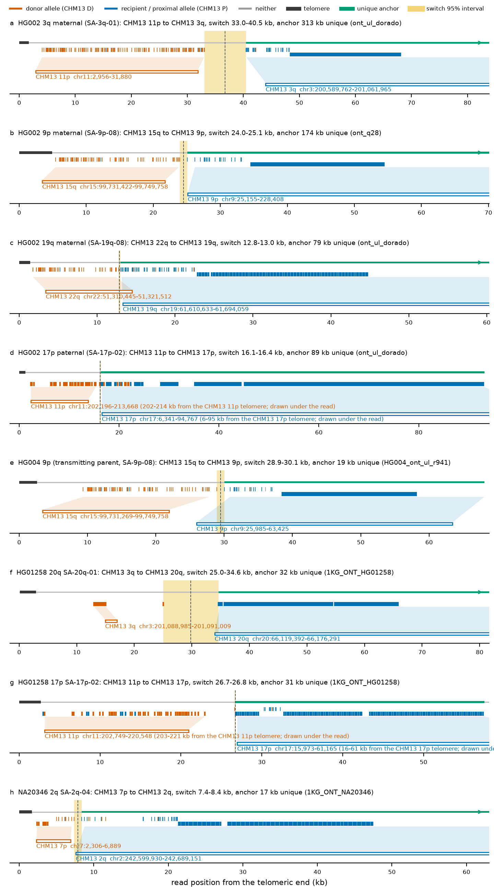
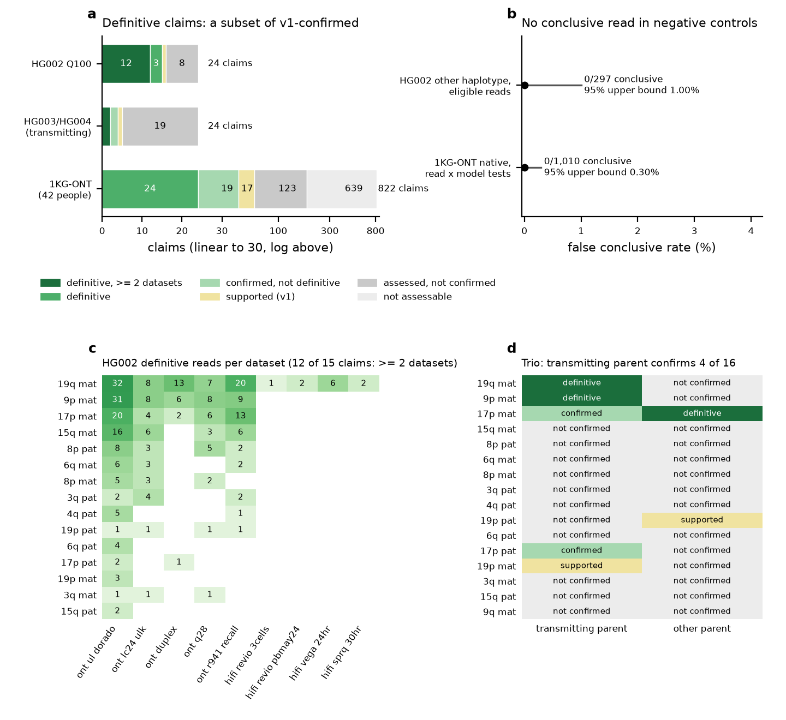
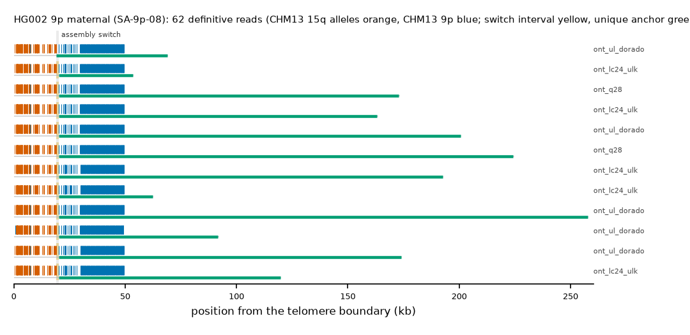

# Read-level evidence for non-native terminal blocks
*Single long reads from public data, tested against pre-registered criteria, show that telomere-adjacent blocks resembling another chromosome arm are real chromosome ends · October 2026 · atlas v0.1 · criteria v1 (a89c5eaf023ed032)*

## Summary

- **Question.** Is a non-native terminal block real, or an assembly artefact? It is a telomere-adjacent block that resembles the CHM13 copy of another arm (donor D) more than the own arm (recipient R). We tested this with single reads not used to build the assemblies.
- **Test.** A conclusive read starts in the telomere. It carries D alleles at paralog-diagnostic sites up to a switch and R alleles beyond it, and it anchors at MAPQ 60 in the recipient chromosome. The criteria were frozen before any population read was inspected.
- **HG002.** All 15 of 24 HG002 Q100 claims confirmed under v1 are also **definitive**, with 301 definitive reads. In 12 of them the definitive reads come from at least 2 independent datasets.
- **Trio.** The transmitting parent (HG003 or HG004; GIAB reads) confirms 4 HG002 claims; 2 of these are definitive.
- **Population.** In 1000 Genomes ONT reads of 42 HPRC individuals, 43 of 822 claims are confirmed and 24 are definitive (74 reads, 14 individuals). Most claims (639) cannot be assessed with these reads.
- **Specificity.** No negative-control read was conclusive: 0 of 297 HG002 other-haplotype tests and 0 of 1,010 1KG-ONT native read × model tests (exact one-sided 95% upper bounds 1.00% and 0.30%).
- **Verify.** Run evidence/replicate_claim.sh CLAIM_ID. It fetches the cited reads from the public files and re-derives every verdict. In a clean-tree test, 9 of 9 claims and controls matched exactly.

## 1. The question

In the atlas, 5,683 of 20,144 HPRC Release 2 chromosome ends (28%) have a non-native core structure: a telomere-adjacent block that resembles the CHM13 copy of another arm (donor D) more than the own arm (recipient R). A skeptic can ask whether such blocks are real chromosome ends or assembly artefacts: mis-joins, collapsed paralogs, or contigs placed on the wrong end. The switch from D-like to R-like sequence lies inside sequence that D and R share (about 98% identity in CHM13). Whole-read alignment to CHM13 therefore usually stays on R and cannot show the structure. At the HG00099 20q carrier, for example, 1 of 575 reads had a supplementary alignment to chr3.

## 2. What would convince a skeptic

A single molecule that (i) begins in the telomere; (ii) carries the donor's alleles at positions where CHM13 D and R differ up to a switch, then the recipient's alleles beyond it, with far more sites than sequencing error could flip; (iii) continues into sequence found only at the recipient end; (iv) shows no sign of a chimera; and (v) aligns best to the claimed end of the same person's own assembly. Such molecules should recur across independent datasets and platforms, and in the parent who transmitted the haplotype. They should be absent in people whose ends are native. The criteria for (i)-(iv) were registered and frozen (hash `a89c5eaf023ed032`) before any population read was inspected. Calibration used HG002 training ends and native controls only (evidence/CRITERIA.md, evidence/calibration/CALIBRATION.md). Criterion (v) and a uniqueness requirement for (iii) form the post-hoc **definitive** tier. It was defined after the population diagnostics (evidence/population/DIAGNOSTICS.md) and can only remove claims.

## 3. Method in one page

**Diagnostic units, from CHM13 alone.** The donor window on D is aligned to the comparator window P (normally R). Inside homologous blocks (≥ 2 kb at ≥ 90%), single-base differences away from indels, homopolymers, low-complexity and locally repeated sequence are SNV sites. Read bins of 200 bp that fall in sequence private to one window are bin units. Each unit is labelled D, P or neither by the read base or bin identity.

**Per read.** The read is oriented telomere-first, and a terminal (CCCTAA)n block of ≥ 300 bp within 300 bp of the end is required. A one- or two-change-point maximum-likelihood segmentation (error rate fixed at 0.05) gives the switch with a 95% profile interval. Each segment needs ≥ 10 units at ≥ 80% purity, and both log10 likelihood ratios against the no-switch models must be ≥ 5. The proximal part is aligned genome-wide (minimap2 map-ont, CHM13 v2.0) and must anchor on the recipient chromosome at MAPQ 60 over ≥ 10 kb, within 2 Mb of the telomere. Integrity: no internal telomere, adapter or foldback, and ≥ 90% of the subtelomeric part aligned. Switch concordance: the read's interval (± 2 kb) overlaps the switch of the person's own assembly window analysed with the same units.

**Claim.** v1 *confirmed* needs ≥ 2 conclusive switch-concordant reads and, for phased HG002 reads, no conclusive contradicting read on the claimed haplotype. A **definitive read** adds two conditions. (a) ≥ 1 kb of the anchor lies on CHM13 recipient positions that no other CHM13 end covers at ≥ 95%. (b) Own-assembly placement: the read has more aligned matching bases on the claimed end window than on any other end window of the same person (HG002: 92 Q100 windows; 1KG-ONT individuals: their about 90 Release 2 windows; HG003/HG004: the HG002 windows, a proxy for the transmitted haplotype). A **definitive claim** is v1 confirmed with ≥ 2 definitive reads from distinct molecules.

**Reads.** HG002: 16 public HG002 Q100 v1.1 read-alignment files (ONT R10.4.1 ultra-long, duplex and other runs, R9.4.1, PacBio HiFi Revio, Vega, SPRQ and DeepConsensus), 12 independent datasets after molecule de-duplication. HERRO-corrected reads are derived from the ultra-long reads and are never counted. Trio: GIAB HG003 and HG004 HiFi (CHM13), ONT ultra-long R9.4.1 and R10.4.1 (GRCh38) alignments. Population: 1000 Genomes ONT Vienna CRAMs (R9.4.1, aligned to CHM13 v2.0) of the 42 HPRC Release 2 individuals in that panel. Reads were fetched only from the outer chromosome-end regions, by HTTP range requests. Per-read error at diagnostic SNV sites (wrong allele): ONT R10 ultra-long 1.0%, duplex 0.06%, HiFi 0.008%.

**Figure 1. Eight exemplar reads, telomere to anchor.** One definitive read per showcase claim. Ticks are diagnostic units (upper row SNV sites, lower row private 200 bp bins), orange for the CHM13 donor allele, blue for the recipient or proximal allele and grey for neither. Yellow: 95% interval of the switch. Green: genome-wide MAPQ-60 anchor with CHM13-unique sequence. Boxes below: the CHM13 coordinates of the donor and recipient segments. Reads, IGV sessions and notes are in evidence/showcase/.

## 4. Results

**HG002 Q100 (phased).** Of 24 non-native HG002 ends, 15 are v1-confirmed and 1 supported. All 15 confirmed claims are definitive, 12 with definitive reads from ≥ 2 independent datasets (301 definitive reads). Of the 8 claims that are not confirmed, 4 have no read that passes the switch test (too few diagnostic units or a mosaic donor block), 1 has switch-passing reads without a terminal telomere, 2 have anchored switch-passing reads that fail integrity, and 1 (16p paternal) has conclusive reads but a switch beyond the 100 kb assembly window, where v1 concordance is undefined (evidence/hg002/README.md).

| Claim | Allele | Donor → recipient | v1 | Conclusive | Definitive | Datasets with definitive reads |
|---|---|---|---|---|---|---|
| 19q mat | SA-19q-08 | 22q → 19q | confirmed | 98 | 91 | hifi_revio_3cells, hifi_revio_pbmay24, hifi_sprq_30hr, hifi_vega_24hr, ont_duplex, ont_lc24_ulk, ont_q28, ont_r941_recall, ont_ul_dorado |
| 9p mat | SA-9p-08 | 15q → 9p | confirmed | 74 | 62 | ont_duplex, ont_lc24_ulk, ont_q28, ont_r941_recall, ont_ul_dorado |
| 17p mat | SA-17p-02 | 11p → 17p | confirmed | 62 | 45 | ont_duplex, ont_lc24_ulk, ont_q28, ont_r941_recall, ont_ul_dorado |
| 15q mat | SA-15q-87 | 11p → 15q | confirmed | 31 | 31 | ont_lc24_ulk, ont_q28, ont_r941_recall, ont_ul_dorado |
| 8p pat | SA-8p-08 | 5q → 8p | confirmed | 18 | 18 | ont_lc24_ulk, ont_q28, ont_r941_recall, ont_ul_dorado |
| 6q mat | SA-6q-02 | 16q → 6q | confirmed | 11 | 11 | ont_lc24_ulk, ont_r941_recall, ont_ul_dorado |
| 8p mat | SA-8p-08 | 6q → 8p | confirmed | 10 | 10 | ont_lc24_ulk, ont_q28, ont_ul_dorado |
| 3q pat | SA-3q-04 | 19p → 3q | confirmed | 8 | 8 | ont_lc24_ulk, ont_r941_recall, ont_ul_dorado |
| 4q pat | SA-4q-02 | 15p → 4q | confirmed | 11 | 6 | ont_r941_recall, ont_ul_dorado |
| 19p pat | SA-19p-04 | 11p → 19p | confirmed | 28 | 4 | ont_lc24_ulk, ont_q28, ont_r941_recall, ont_ul_dorado |
| 6q pat | SA-6q-02 | 16q → 6q | confirmed | 12 | 4 | ont_ul_dorado |
| 17p pat | SA-17p-02 | 11p → 17p | confirmed | 7 | 3 | ont_duplex, ont_ul_dorado |
| 19p mat | SA-19p-04 | 11p → 19p | confirmed | 15 | 3 | ont_ul_dorado |
| 3q mat | SA-3q-01 | 11p → 3q | confirmed | 7 | 3 | ont_lc24_ulk, ont_q28, ont_ul_dorado |
| 15q pat | SA-15q-65 | 3q → 15q | confirmed | 2 | 2 | ont_ul_dorado |
| 9q mat | SA-9q-28 | 20q → 9q | supported | 1 | 1 | ont_lc24_ulk |

**Trio.** Each HG002 claim was tested in both parents, using unphased reads and the unphased rule. The transmitting parent confirms 4 claims and supports 1; 2 are definitive. Contradicting reads in a parent come from the parent's other haplotype at that arm. They are expected, and they do not block an unphased confirmation. HG002 carries SA-17p-02 (11p-like) on both haplotypes. The father, HG003, transmitted the paternal copy, so his reads also confirm the maternal 17p claim.

| HG002 claim | Transmitting parent | v1 | Conclusive | Definitive | Contradicting | Other parent (v1) |
|---|---|---|---|---|---|---|
| 9p mat | HG004 | confirmed | 13 | 10 | 0 | HG003: not_confirmed |
| 19q mat | HG004 | confirmed | 6 | 6 | 4 | HG003: not_confirmed |
| 17p pat | HG003 | confirmed | 4 | 1 | 0 | HG004: not_confirmed |
| 17p mat | HG004 | confirmed | 5 | 1 | 12 | HG003: confirmed |
| 19p mat | HG004 | supported | 1 | 0 | 0 | HG003: not_confirmed |

**1000 Genomes ONT (unphased, R9.4.1).** 822 claims (individual × arm × allele) in 42 individuals: 43 confirmed, 17 supported, 24 definitive. The others: 639 not assessable (diagnostic units 391, read length 131, anchor 93, no telomere read 19, no reads 4, model window undefined 1); 123 assessed but not confirmed (switch test 43, contradicting only 38, one conclusive 18, discordant 17, integrity 7). Of the 19 confirmed claims that are not definitive, 15 rest on reads whose anchor lies only in CHM13-shared sequence (mostly 2q SA-2q-02) and 8 include reads that align best to another end of the same person. These are often the other haplotype at the same arm, which carries a related allele (e.g. HG00235 20q SA-20q-06, whose reads place on the SA-20q-01 haplotype). The definitive claims:

| Allele | Arm | Donor | Definitive claims | Individuals | Definitive reads |
|---|---|---|---|---|---|
| SA-12p-04 | 12p | 19p | 1 | HG02976 | 2 |
| SA-17p-02 | 17p | 11p | 2 | HG01258, HG03130 | 8 |
| SA-17p-16 | 17p | 11p | 1 | NA18983 | 2 |
| SA-17p-17 | 17p | 11p | 1 | HG00235 | 4 |
| SA-17q-02 | 17q | 6q | 1 | NA19043 | 2 |
| SA-19q-02 | 19q | 4q | 3 | HG00235, NA18983, NA20762 | 8 |
| SA-19q-04 | 19q | 7p | 1 | NA19391 | 6 |
| SA-19q-08 | 19q | 22q | 1 | HG00235 | 7 |
| SA-19q-14 | 19q | 21q | 1 | NA19391 | 3 |
| SA-20p-02 | 20p | 16q | 1 | NA18983 | 2 |
| SA-20p-37 | 20p | 9q | 1 | NA20346 | 3 |
| SA-20q-01 | 20q | 3q | 8 | HG00128, HG00133, HG00146, HG00235, HG00321, HG01258, HG02976, NA19391 | 21 |
| SA-2q-04 | 2q | 7p | 1 | NA20346 | 2 |
| SA-5q-51 | 5q | 6q | 1 | HG03742 | 4 |

**Negative controls.** HG002 reads from the other haplotype at the same arm, where that haplotype is strictly native: 0 of 297 eligible read tests conclusive (95% upper bound 1.00%). 1KG-ONT individuals strictly native in both haplotypes, each tested against every allele model of the arm: 0 of 1,010 eligible read × model tests conclusive (318 cited control reads; bound 0.30%). Controls mostly *contradict*, that is, they show the native arm in the claimed donor interval. Nine claimed arms have no strictly native individual among the 42.

**Figure 2. Summary.** (a) Claims by cohort and tier (trio: transmitting parent). (b) Negative controls with exact one-sided 95% upper bounds. (c) HG002 definitive reads per claim and dataset. (d) Verdict in the transmitting and in the other parent for each HG002 claim with read support.

## 5. Worked example: HG002 maternal 9p

Claim `HG002#2#chr9_MATERNAL#L`: allele SA-9p-08. The maternal 9p end carries a CHM13 15q-like block before 9p sequence; the assembly switch is 19,636 bp from the telomere boundary. Under v1 it has 74 conclusive switch-concordant reads and is definitive with 62 definitive reads from 5 datasets. The mother (HG004) confirms it. One read, from the R10 ultra-long dataset, is `7f6d888f-4c3f-4b04-a10d-c1f1caffa110`, 176,075 bp, with a telomere of 2,658 bp. It has 76 donor-segment units at 99% 15q alleles and 118 proximal units at 100% 9p alleles. The switch lies at 18,908-21,306 bp (CHM13 chr9:22757-25155). The anchor is chr9:25155-177563 at MAPQ 60, 127,386 bp of it CHM13-unique. The read places best on `HG002#2#chr9_MATERNAL#L` at 99.2% identity.

Fetch the read from the public alignment file:

`samtools view -F 0x900 -X 'https://human-pangenomics.s3.amazonaws.com/T2T/HG002/assemblies/polishing/HG002/v1.1/mapping/ont_r10_ul_dorado/hg002v1.1_ont_r10_ul_dorado.pri.bam' 'https://human-pangenomics.s3.amazonaws.com/T2T/HG002/assemblies/polishing/HG002/v1.1/mapping/ont_r10_ul_dorado/hg002v1.1_ont_r10_ul_dorado.pri.bam.bai' 'chr9_MATERNAL:1-52422' | awk -v r='7f6d888f-4c3f-4b04-a10d-c1f1caffa110' '$1==r'`

Split at the switch interval and aligned genome-wide, the distal segment of each showcase read aligns to CHM13 15q (6 of 6) and the proximal segment to CHM13 9p at MAPQ 60 (6 of 6) (evidence/showcase/HG002_2_chr9_MATERNAL_L/). Re-derive the claim from public data:

`evidence/replicate_claim.sh 'HG002#2#chr9_MATERNAL#L'`

**Figure 3. All definitive reads of HG002 maternal 9p** (12 of the most informative shown). Reads are aligned at the telomere boundary, with units coloured by CHM13 allele, per-read switch interval in yellow, unique anchor in green and the own-assembly switch as a grey band.

## 6. Alternative explanations and how each is excluded

**Chimeric reads.** Definitive reads have no internal telomere, adapter or foldback, and ≥ 90% of the subtelomeric part aligns. Their switches fall, within ± 2 kb, where the person's own assembly places them, and the same switch recurs in independent molecules, datasets and platforms and in the transmitting parent. Ligation chimeras form at random positions and would not recur.

**Mis-mapping and paralogs.** This is the main risk. Diagnostic units tell which CHM13 end a segment resembles, but human haplotypes carry blocks that CHM13 lacks. In the population diagnostics, 19 SA-3q-01 reads were MAPQ-60 on chr3 with 0 unique bp; they came from 6p, 20q and 9q haplotypes that carry 3q-like sequence. Assembly-switch concordance had already kept them from confirming SA-3q-01. The definitive tier excludes the mechanism explicitly: it requires unique anchor sequence and best placement on the claimed end among all of the person's ends.

**Assembly error.** The read test is assembly-free. Units come from CHM13; the 1KG-ONT reads (another laboratory, DNA extraction and platform) and the GIAB parental reads were not used for the assemblies. Assemblies are used only to locate the expected switch and in the post-hoc placement step.

**Population variation at diagnostic sites.** Carrier haplotypes differ from CHM13 at some sites. Purity thresholds are therefore 0.80, and true-carrier donor purity goes as low as 0.80 (calibration T0). Such variation lowers purity in both segments. It does not create an ordered donor-then-recipient pattern with log10 likelihood ratios ≥ 5 against both no-switch models. No native control read did.

**Duplicate molecules and derived reads.** HG002 reads are de-duplicated across datasets by ONT read UUID or PacBio movie and ZMW. HERRO-corrected reads are reported but never counted. Definitive claims count distinct molecules.

## 7. Limits

**Sensitivity.** A read must reach the telomere and pass the switch by ≥ 10 kb. For HG002 ONT R10 ultra-long reads, read-level sensitivity (calibration: conclusive / eligible carrier reads) rises with length, from 11% for 25-50 kb reads to 51% for reads > 200 kb (calibration/sensitivity_by_length.tsv). The R9.4.1 1KG-ONT reads are shorter, and most population claims are *not assessable* (639 of 822). That is no evidence against them. **Model limits.** Claims whose assembly switch is at the edge of the v1 donor window (18 claims, including SA-20p-03) are treated as not assessable. Switches beyond the 100 kb assembly window have undefined concordance. **Controls.** Nine claimed arms (12p, 17q, 19p, 19q, 1p, 3q, 4q, 6q, Yq) have no strictly native individual among the 42. **Post-hoc tier.** The definitive tier was defined after the population diagnostics. It is stricter than v1 and only removes claims. Its placement step uses the person's assembly, so it is not assembly-free. For HG003/HG004 it is a proxy (placement on HG002 windows). **Software.** Verdicts depend on minimap2/mappy versions (2.31 here).

## 8. Evidence files and replication

evidence/claims.tsv has one row per claim (894: cohort, individual, haplotype, arm, allele, nativity, D/P/R, assembly switch and its CHM13 projection, read counts by tier and dataset, v1 and definitive verdicts, diagnostics note). evidence/reads.tsv.gz has one row per cited read (5,937 rows): public source URL and index, region, read group, read length, strand, telomere, donor/recipient units and purity, switch interval in read, subtelomere and CHM13 coordinates, anchor position, MAPQ and unique bp, own-assembly placement and identity, tier, and the samtools command that retrieves the read. evidence/showcase/ holds eight exemplar claims (16.8 MB): CRAM and BAM on CHM13 v2.0 (read groups name the public source; @SQ M5 tags; no local paths), BAM on the person's own end windows with the window FASTA, read segments split at the switch, a BED of the claim model, and IGV sessions with a "what you should see" note. The full set (122 claims with a conclusive read) is packaged as GitHub release assets: subtel_read_evidence_v1_1KG_ONT.tar.gz (23.7 MB); subtel_read_evidence_v1_HG002_Q100.tar.gz (190.3 MB); subtel_read_evidence_v1_HG002_trio.tar.gz (16.3 MB); subtel_read_evidence_v1_tables.tar.gz (0.7 MB). SHA-256 checksums are in evidence/release_manifest.tsv.

evidence/replicate_claim.sh CLAIM_ID works from a clean checkout with internet, samtools and minimap2. It verifies the criteria hash, downloads CHM13 v2.0, cuts the person's end windows from the public assembly (SHA-256-checked), fetches the cited reads by region and read ID from the public files, re-runs the frozen criteria and the definitive tier, and compares every verdict with the published tables (evidence/REPLICATION_TEST.md).

| Claim | Kind | Cited reads | Published | Replicated | Reads identical | Wall (s) |
|---|---|---|---|---|---|---|
| HG002#2#chr3_MATERNAL#R | HG002 Q100 | 136 | confirmed / definitive_multi_dataset (7 conclusive) | confirmed / definitive_multi_dataset (7 conclusive) | 136/136 | 328 |
| HG002#1#chr17_PATERNAL#L | HG002 Q100 | 107 | confirmed / definitive_multi_dataset (7 conclusive) | confirmed / definitive_multi_dataset (7 conclusive) | 107/107 | 907 |
| HG002#1#chr15_PATERNAL#R | HG002 Q100 | 36 | confirmed / definitive (2 conclusive) | confirmed / definitive (2 conclusive) | 36/36 | 295 |
| HG002#2#chr9_MATERNAL#L | HG002 Q100 | 190 | confirmed / definitive_multi_dataset (74 conclusive) | confirmed / definitive_multi_dataset (74 conclusive) | 190/190 | 528 |
| HG01258/20q/SA-20q-01 | 1KG-ONT | 5 | confirmed / definitive (4 conclusive) | confirmed / definitive (4 conclusive) | 5/5 | 126 |
| HG01258/17p/SA-17p-02 | 1KG-ONT | 6 | confirmed / definitive (5 conclusive) | confirmed / definitive (5 conclusive) | 6/6 | 135 |
| NA20346/2q/SA-2q-04 | 1KG-ONT | 10 | confirmed / definitive (3 conclusive) | confirmed / definitive (3 conclusive) | 10/10 | 131 |
| NA18960/2q/SA-2q-02 | 1KG-ONT | 16 | confirmed / confirmed_not_definitive (8 conclusive) | confirmed / confirmed_not_definitive (8 conclusive) | 16/16 | 106 |
| control/HG00133/20p/SA-20p-10 | control (1KG-ONT) | 20 | 0 conclusive | 0 conclusive | 20/20 | 106 |

## 9. Data provenance, licences and how to cite

HPRC Release 2 assemblies (public domain; HPRC data-use best practice; BioProject PRJNA730823; Liao et al. 2023). HG002 Q100 v1.1 assembly and read alignments (T2T/GIAB; human-pangenomics S3). GIAB HG003/HG004 reads (NIST, Ashkenazi trio; NCBI FTP) and ONT Open Data (giab_2023.05). 1000 Genomes ONT Vienna panel (Schloissnig, Pani et al. 2025): reads generated at IMP Vienna from Coriell DNA consented for public release. We used them for a targeted analysis of chromosome-end regions under the panel's data reuse statement, and the evidence files redistribute only the few hundred cited reads. CHM13 v2.0 (T2T consortium; Nurk et al. 2022). Atlas tables, figures and text are CC BY 4.0, code MIT (DATA_LICENSE.md). We acknowledge the Human Pangenome Reference Consortium (BioProject PRJNA730823) and its funder, the National Human Genome Research Institute (NHGRI).

How to cite: Human subtelomere atlas v0.1, read-level evidence (criteria v1, a89c5eaf023ed032), https://github.com/jlanej/human-subtelomere-atlas (CITATION.cff), together with the read sources above.

## References

- Nurk S, et al. (2022). The complete sequence of a human genome. *Science* 376:44-53. doi:10.1126/science.abj6987
- Liao W-W, et al. (2023). A draft human pangenome reference. *Nature* 617:312-324. doi:10.1038/s41586-023-05896-x
- Schloissnig S, Pani S, et al. (2025). Structural variation in 1,019 diverse humans based on long-read sequencing. *Nature*. doi:10.1038/s41586-025-09290-7 (preprint doi:10.1101/2024.04.18.590093)
- Zook JM, et al. (2016). Extensive sequencing of seven human genomes to characterize benchmark reference materials. *Scientific Data* 3:160025. doi:10.1038/sdata.2016.25
- Li H (2018). Minimap2: pairwise alignment for nucleotide sequences. *Bioinformatics* 34:3094-3100. doi:10.1093/bioinformatics/bty191
- Tan KT, et al. (2022). Identifying and correcting repeat-calling errors in nanopore sequencing of telomeres. *Genome Biology* 23:180. doi:10.1186/s13059-022-02751-6
- Tan et al. (2026). Widespread structural variations at human chromosome ends. bioRxiv. doi:10.64898/2026.09.03.748401
