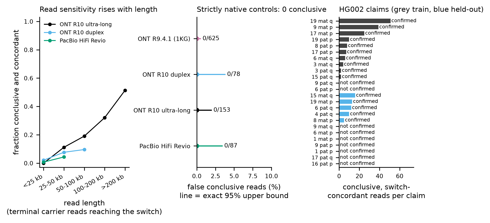
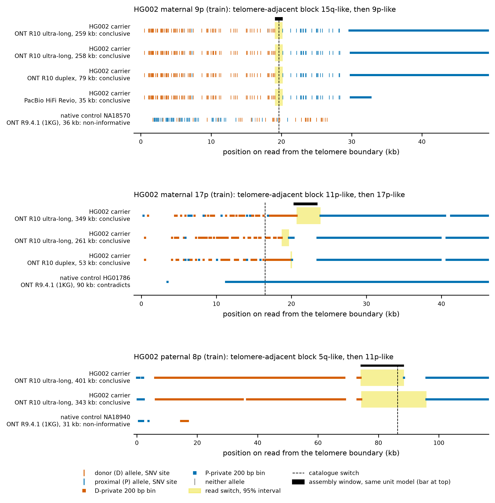

# Read-evidence calibration (criteria v1)

Calibration of the read-level evidence method for non-native terminal blocks. The method is defined in
[../CRITERIA.md](../CRITERIA.md), implemented in `atlas/subtel_atlas/readevidence.py` (`subtel-atlas reads-evidence`), and
uses the frozen thresholds in [../criteria_v1.json](../criteria_v1.json) (sha `a89c5eaf023ed032`). It is assembly-free: each
read is tested against CHM13 v2.0 only. The person's assembly enters only the secondary switch-concordance line.

## Design

* **Claims.** 24 HG002 Q100 v1.1 non-native ends (20 foreign, 4 within-family), one claim each, derived by the pre-registered
  rule (CRITERIA.md section 1). They are split into a training half and a held-out half (sorted end_id, alternating;
  12 + 12).
* **Reads.** Fetched by region (outer 5 kb of each contig end, primary alignments) from the public HG002 Q100 v1.1 read
  alignments:
  * ONT R10 ultra-long (dorado);
  * ONT R10 duplex;
  * PacBio HiFi Revio (3 cells).
  This gives 84 slices, 2,948 records (`evidence/scripts/fetch_reads.py`; manifest with URLs, regions and SHA-256 in
  `work/readevidence/hg002_fetch_manifest.tsv`).
* **Negative controls** (specificity; no carrier reads of any population sample were fetched or inspected):
  * HG002 reads of the other haplotype at the same arm where that haplotype is **strictly native**, i.e. its raw mosaic
    structure is only `home`: 16p, 17q and 4q maternal;
  * 1000 Genomes ONT (Vienna) R9.4.1 reads aligned to CHM13 v2.0 (Schloissnig, Pani et al. 2025,
    doi:10.1038/s41586-025-09290-7), at the same arm, from individuals strictly native in both haplotypes per the catalogue.
    This is 16 sample-arms among the 42 HPRC Release 2 individuals in that panel, covering 15q, 16p, 17p, 6p, 8p, 9p and 9q.
* **Reported only.** Core-native controls: non-home raw blocks shorter than 10 kb, which the catalogue's core structure
  ignores. These are 22 further 1KG sample-arms and HG002 19q paternal. Other-haplotype HG002 reads carrying the same or a
  different non-native block are also reported only.
* **Order of operations.**
  1. Pre-registration.
  2. Training run with the pre-registered criteria (`calib_train_prereg`).
  3. Calibration changes A1 and C1-C3, recorded in `criteria_v1.json` (`calibration_changes`) and CRITERIA.md; no numeric
     threshold was changed.
  4. Freeze.
  5. Training re-run and held-out run with the frozen criteria.

  All numbers below come from step 5.

## Per-read error at diagnostic SNV sites

Each read's call at each diagnostic SNV site was compared with the haplotype consensus of all carrier reads covering the site
(≥5 reads, ≥80% agreement). The script is `evidence/scripts/site_error_rates.py`; the output is
[site_error_rates.tsv](site_error_rates.tsv) and [site_error_summary.tsv](site_error_summary.tsv).

| platform | reads | sites | wrong allele | neither allele | median read error | 95th pct read error |
|---|---|---|---|---|---|---|
| PacBio HiFi Revio | 338 | 25,081 | 0.008% | 0.080% | 0.0% | 0.9% |
| ONT R10 duplex | 379 | 35,613 | 0.056% | 0.22% | 0.0% | 1.8% |
| ONT R10 ultra-long | 702 | 67,041 | 1.02% | 2.70% | 1.5% | 22.4% |

All are below the fixed change-point error parameter e = 0.05. In strictly native 1KG reads, the claimed donor interval shows
10.3% donor calls at SNV sites (6,416 sites, 86 reads; the maximum for one read is 71%). This rate exceeds the R9 site-error
rate and reflects population variation at paralog-diagnostic sites. Single sites are therefore not evidence: the verdict
requires segment-level purity, a likelihood-ratio switch, a terminal telomere and a MAPQ-60 anchor together.

## Read-level sensitivity and specificity

Columns:
* eligible = carrier read with a terminal telomere and length ≥ s0 + switch + 10 kb;
* sensitivity = conclusive **and** switch-concordant / eligible (exact 95% CI);
* negative controls = strictly native control reads; the bound in brackets is the exact one-sided 95% upper bound of the
  false-conclusive rate;
* "eligible neg." = control reads that could have crossed the switch with a full anchor.

Full table: [read_metrics.tsv](read_metrics.tsv); by length: [sensitivity_by_length.tsv](sensitivity_by_length.tsv).

| half | platform | carrier reads | sensitivity (eligible) | carrier reads contradicting | false conclusive (all neg.) | false conclusive (eligible neg.) | neg. reads contradicting |
|---|---|---|---|---|---|---|---|
| train | ONT_R10_UL | 592 | 126/335 (37.6%; 32.4%-43.0%) | 0 | n/a | n/a | 0 |
| train | ONT_R10_duplex | 301 | 25/126 (19.8%; 13.3%-27.9%) | 0 | n/a | n/a | 0 |
| train | HiFi_Revio | 321 | 1/14 (7.1%; 0.2%-33.9%) | 0 | n/a | n/a | 0 |
| train | ONT_R9.4.1 | 0 | n/a | 0 | 0/407 (<= 0.73%) | 0/70 | 30 |
| train | all | 1214 | 152/475 (32.0%; 27.8%-36.4%) | 0 | 0/407 (<= 0.73%) | 0/70 | 30 |
| heldout | ONT_R10_UL | 593 | 56/312 (17.9%; 13.9%-22.7%) | 1 | 0/153 (<= 1.94%) | 0/39 | 62 |
| heldout | ONT_R10_duplex | 321 | 0/111 (0.0%; 0.0%-3.3%) | 0 | 0/78 (<= 3.77%) | 0/6 | 21 |
| heldout | HiFi_Revio | 282 | 0/6 (0.0%; 0.0%-45.9%) | 0 | 0/87 (<= 3.38%) | n/a | 14 |
| heldout | ONT_R9.4.1 | 0 | n/a | 0 | 0/218 (<= 1.36%) | 0/30 | 9 |
| heldout | all | 1196 | 56/429 (13.1%; 10.0%-16.6%) | 1 | 0/536 (<= 0.56%) | 0/75 | 106 |
| all | ONT_R10_UL | 1185 | 182/647 (28.1%; 24.7%-31.8%) | 1 | 0/153 (<= 1.94%) | 0/39 | 62 |
| all | ONT_R10_duplex | 622 | 25/237 (10.5%; 6.9%-15.2%) | 0 | 0/78 (<= 3.77%) | 0/6 | 21 |
| all | HiFi_Revio | 603 | 1/20 (5.0%; 0.1%-24.9%) | 0 | 0/87 (<= 3.38%) | n/a | 14 |
| all | ONT_R9.4.1 | 0 | n/a | 0 | 0/625 (<= 0.48%) | 0/100 | 39 |
| all | all | 2410 | 208/904 (23.0%; 20.3%-25.9%) | 1 | 0/943 (<= 0.32%) | 0/145 | 136 |

**Specificity.** No strictly native control read was conclusive: 0 of 943, with a 95% upper bound of 0.32%, and 0 of 145
eligible control reads (upper bound 2.0%). The control reads were 318 HG002 R10/HiFi and 625 1KG R9.4.1, and 136 of them
contradict their claim.

**Carrier contradictions.** One of 2,410 carrier reads contradicts its claim: HG002 1p paternal, a within-family 6q-like block
with only 2 donor units (see below).

**Core-native controls.** Short non-home raw blocks are real sequence. Conclusive reads arise here (41 of 90 HG002 19q
paternal reads, 8 of 1,366 1KG reads), and the claim-level rule rejects them because their switches are discordant (6-10 kb
against the claimed 14.3 kb at 19q).

**Sensitivity.** Sensitivity is limited by the anchor, not by the allele test: of 615 eligible carrier reads that pass the
switch test, 385 (63%) have no MAPQ-60 anchor of ≥10 kb on the recipient chromosome. Recipient ends 3q, 4q, 9q and 19p share
100-200 kb with other CHM13 ends at ≥95% identity. Overall per-read sensitivity on eligible carrier reads is 23.0%
(208/904; ONT ultra-long 28.1%). Restricted to the 15 confirmed claims, ONT ultra-long sensitivity is 45.5% (182/400 eligible
reads), and it rises with read length to 51% for reads > 200 kb (figure, panel a). HiFi and duplex reads are rarely
conclusive for switches beyond ~15 kb because they seldom reach a MAPQ-60 anchor, but they give the lowest site error.

**Conclusive carrier reads.** There are 222 conclusive carrier reads (194 ONT ultra-long, 26 duplex, 2 HiFi):
* 210 are switch-concordant (218 tested against the assembly projection, 4 against the catalogue switch);
* 161 are concordant with the catalogue switch itself;
* 196 have an anchor tier of `unique`, i.e. ≥1 kb of anchor outside sequence shared with another CHM13 end at ≥95%;
* 214 also align contiguously, without a supplementary alignment, to the claimed HG002 Q100 contig end (own-assembly line).



## Claim-level results (frozen criteria)

Columns:
* switch = catalogue switch (subtelomere bp);
* assembly projection = the claim's unit model applied to the HG002 Q100 end window (95% interval, subtelomere bp);
* conc./disc. = conclusive reads that are switch-concordant / discordant;
* controls = conclusive / reads among strictly native controls.

Source: [claims_calibration.tsv](claims_calibration.tsv).

| half | end | pattern | D>P | switch | assembly projection | conc. | disc. | consistent | contradicts | datasets (conclusive) | controls | verdict |
|---|---|---|---|---|---|---|---|---|---|---|---|---|
| heldout | chr16_PATERNAL#L | DP | chr9q>chr16p | >window | no switch | 0 | 2 | 0 | 0 |  | 0/111 | **not confirmed** |
| heldout | chr17_PATERNAL#R | PDP | chr5q>chr17q | 43,819 | no switch | 0 | 0 | 0 | 0 |  | 0/119 | **not confirmed** |
| heldout | chr1_PATERNAL#L | DP | chr6q>chr1p | 10,661 | no switch | 0 | 0 | 0 | 1 |  | 0/0 | **not confirmed** |
| heldout | chr4_PATERNAL#R | DP | chr15p>chr4q | 29,632 | 29,500-30,300 | 10 | 0 | 32 | 0 | ont_ul_dorado | 0/97 | **confirmed** |
| heldout | chr6_PATERNAL#R | DP | chr16q>chr6q | 13,442 | 15,180-15,275 | 12 | 0 | 59 | 0 | ont_ul_dorado | 0/0 | **confirmed** |
| heldout | chr9_PATERNAL#L | DP | chr3q>chr9p | 11,594 | no switch | 0 | 0 | 0 | 0 |  | 0/29 | **not confirmed** |
| heldout | chr15_MATERNAL#R | DP | chr11p>chr15q | 17,564 | 18,595-19,711 | 16 | 0 | 33 | 0 | ont_ul_dorado | 0/37 | **confirmed** |
| heldout | chr19_MATERNAL#L | DP | chr11p>chr9p | 15,370 | 8,199-8,389 | 13 | 0 | 45 | 0 | ont_ul_dorado | 0/0 | **confirmed** |
| heldout | chr1_MATERNAL#L | PDP | chr5q>chr1p | 49,300 | no switch | 0 | 0 | 0 | 0 |  | 0/0 | **not confirmed** |
| heldout | chr6_MATERNAL#L | DP | chr3q>chr20q | 29,263 | no switch | 0 | 0 | 0 | 0 |  | 0/17 | **not confirmed** |
| heldout | chr8_MATERNAL#L | DP | chr6q>chr11p | 85,573 | 73,500-93,700 | 5 | 0 | 6 | 0 | ont_ul_dorado | 0/61 | **confirmed** |
| heldout | chr9_MATERNAL#R | DP | chr20q>chr19p | 18,521 | 16,116-18,171 | 0 | 0 | 58 | 0 |  | 0/65 | **not confirmed** |
| train | chr15_PATERNAL#R | DP | chr3q>chr15q | 24,486 | no switch | 2 | 0 | 8 | 0 | ont_ul_dorado | 0/37 | **confirmed** |
| train | chr17_PATERNAL#L | DP | chr11p>chr17p | 20,251 | 16,500-16,700 | 7 | 10 | 11 | 0 | ont_duplex,ont_ul_dorado | 0/99 | **confirmed** |
| train | chr19_PATERNAL#L | DP | chr11p>chr9p | 13,382 | 6,224-6,414 | 10 | 0 | 56 | 0 | ont_ul_dorado | 0/0 | **confirmed** |
| train | chr3_PATERNAL#R | DP | chr19p>chr3q | 35,425 | 30,836-43,764 | 2 | 0 | 34 | 0 | ont_ul_dorado | 0/0 | **confirmed** |
| train | chr6_PATERNAL#L | DP | chr11p>chr3q | 11,220 | no switch | 0 | 0 | 0 | 0 |  | 0/17 | **not confirmed** |
| train | chr8_PATERNAL#L | DP | chr5q>chr11p | 86,330 | 74,100-88,500 | 8 | 0 | 11 | 0 | ont_ul_dorado | 0/61 | **confirmed** |
| train | chr9_PATERNAL#R | DP | chr11p>chr19p | 17,621 | 15,178-19,749 | 0 | 0 | 61 | 0 |  | 0/65 | **not confirmed** |
| train | chr17_MATERNAL#L | DP | chr11p>chr17p | 16,501 | 20,300-23,500 | 25 | 0 | 12 | 0 | ont_duplex,ont_ul_dorado | 0/99 | **confirmed** |
| train | chr19_MATERNAL#R | DP | chr22q>chr19q | 14,270 | 14,189-14,443 | 51 | 0 | 52 | 0 | hifi_revio_3cells,ont_duplex,ont_ul_dorado | 0/0 | **confirmed** |
| train | chr3_MATERNAL#R | DP | chr11p>chr3q | 36,576 | 31,339-38,758 | 4 | 0 | 31 | 0 | ont_ul_dorado | 0/0 | **confirmed** |
| train | chr6_MATERNAL#R | DP | chr16q>chr6q | 11,467 | 14,333-14,428 | 6 | 0 | 51 | 0 | ont_ul_dorado | 0/0 | **confirmed** |
| train | chr9_MATERNAL#L | DP | chr15q>chr9p | 19,636 | 19,080-20,196 | 39 | 0 | 12 | 0 | hifi_revio_3cells,ont_duplex,ont_ul_dorado | 0/29 | **confirmed** |

**Training half: 10 of 12 confirmed.** Four claims are confirmed by two or more independent datasets:
* 19q maternal and 9p maternal: ONT ultra-long, ONT duplex and HiFi;
* 17p paternal and 17p maternal: ONT ultra-long and duplex.

**Held-out half: 5 of 12 confirmed** (15q maternal, 19p maternal, 6q paternal, 4q paternal, 8p maternal), all by ONT
ultra-long reads only. No held-out claim was contradicted. The unconfirmed held-out claims fail for reasons visible in the
per-read fields, and the criteria were **not** changed in response:

* **Too few donor units** (fewer than 10 per segment): 17q paternal (internal 5q-like block; PDP), 9p paternal (11.6 kb
  3q-like block), 1p paternal (within-family 6q-like block, 2 donor units, donor interval of mixed state), and training claim
  6p paternal. In these blocks CHM13 D and P share short (<2 kb) homologies, so few bins are private and the D window has no
  ≥2 kb homologous block for SNV sites.
* **Mosaic donor block.** At 1p maternal and 6p maternal the outermost core block consists of several raw blocks: 5q/6q, and
  11p|20q|3q. The v1 claim takes the single dominant D, so donor-segment purity is only 0.63-0.64. A raw-block-resolved claim
  (one test per raw block) would address this. It is not part of v1 and would need its own calibration.
* **No anchor.** 9q maternal and training claim 9q paternal (58-61 consistent reads each): the recipient 9q end is ≥95%
  shared with other CHM13 ends over ~100 kb, and the following sequence is 19p-like (PF04). No read reaches a MAPQ-60 anchor
  on chr9.
* **Switch beyond the assembly window.** 16p paternal: two ONT ultra-long reads (314 and 264 kb) are conclusive with the
  switch at subtelomere ~107 kb (interval 107-201 kb). The catalogue reports the 9q-like block running to the end of its
  100 kb window. v1 does not define concordance for a switch beyond the window, so the claim is recorded as not confirmed.

Across both halves, **15 of 24 HG002 claims are confirmed by reads alone**, none is contradicted, and no strictly native
control read is conclusive.

## Exemplars

Diagnostic-unit tracks along single reads, telomere boundary at 0:
* ticks = SNV sites; squares = private 200 bp bins; orange = donor allele, blue = proximal allele;
* yellow = 95% switch interval of the read;
* dashed line = catalogue switch; black bar = assembly projection of the switch.

Each panel shows up to four conclusive carrier reads from different platforms and one strictly native 1KG control read at the
same arm. The 17p maternal panel shows the catalogue switch (16.5 kb, 5 kb sliding identity) lying 4-7 kb distal of the
diagnostic-unit switch, which reads and the assembly projection place at 20-23.5 kb (calibration change C2).



## Evidence files

* Per-read rows: [reads_train.tsv.gz](reads_train.tsv.gz) and [reads_heldout.tsv.gz](reads_heldout.tsv.gz), with all
  evidence fields (columns in `readevidence.READ_COLS` plus role, half and claim).
* Per-unit calls: `work/readevidence/calib_*_frozen/units.json.gz` (git-ignored; regenerated by the commands below).
* Evidence BAMs of the 222 conclusive carrier reads, tagged `XC` = claim:concordance and `XD` = dataset (git-ignored, 47 MB):
  * `work/readevidence/evidence_bam/hg002_conclusive_reads.chm13v2.bam`: CHM13 v2.0 alignments;
  * `work/readevidence/evidence_bam/hg002_conclusive_reads.hg002q100.bam`: the original HG002 Q100 alignments.

## Reproduce

```
source work/config.local.sh            # ATLAS_INPUT_DIR: CHM13 v2.0 FASTA and 500 kb ends (or: subtel-atlas fetch-refs)
minimap2 -x map-ont -d work/readevidence/chm13v2.map-ont.mmi chm13v2.0.fa.gz
python evidence/scripts/fetch_reads.py hg002 --ends work/readevidence/hg002_ends.tsv --datasets ont_ul_dorado,hifi_revio_3cells,ont_duplex
python evidence/scripts/fetch_reads.py ont1kg --ends work/readevidence/ont1kg_strict_native_controls.tsv --chm13 chm13v2.0.fa.gz
python evidence/scripts/fetch_reads.py ont1kg --ends work/readevidence/ont1kg_native_controls.tsv --chm13 chm13v2.0.fa.gz
for h in train heldout; do
  python evidence/scripts/run_calibration.py --phase $h --chm13-ends chm13_ends500k.fa \
      --genome work/readevidence/chm13v2.map-ont.mmi --out work/readevidence/calib_${h}_frozen -t 8
done
python evidence/scripts/site_error_rates.py --chm13-ends chm13_ends500k.fa --out evidence/calibration
python evidence/scripts/calibration_report.py --train work/readevidence/calib_train_frozen --heldout work/readevidence/calib_heldout_frozen
```

A single claim straight from the public alignment (about 20 s):
```
subtel-atlas reads-evidence https://human-pangenomics.s3.amazonaws.com/T2T/HG002/assemblies/polishing/HG002/v1.1/mapping/hifi_revio_3cell/hg002v1.1_hifi_revio_3cells.bam \
    --region chr19_MATERNAL:61312337-61317335 --claim 'HG002#2#chr19_MATERNAL#R' --genome chm13v2.map-ont.mmi \
    --preset map-hifi --platform HiFi_Revio --phased --assembly-window window.fa --evidence-bam -o 19q_mat
```
The end-list TSVs in `work/readevidence/` are derived from `data/catalogue/ends.tsv` (selection rules above). Runtime on
8 threads is about 15 min per half, plus 10 min for site errors.

## Limitations

* Per-read sensitivity is modest (23% of eligible carrier reads) and platform-dependent. It is dominated by MAPQ-60 anchor
  failures in recipient ends that share 100-200 kb with other CHM13 ends. Confirming a claim needs ultra-long reads
  (≥100 kb) for switches inside such ends.
* Specificity was measured on 943 strictly native control reads covering 9 arms (HG002: 16p, 17q, 4q; 1KG: 15q, 16p, 17p,
  6p, 8p, 9p, 9q). No strictly native control exists in this set for 1p, 3q, 6q, 19p or 19q, so for claims at those arms the
  false-conclusive rate is extrapolated, not measured.
* ONT R9.4.1 telomeres are detected only with the artefact motifs of C1 (72% of end-reaching reads). Carrier sensitivity on
  1KG-ONT reads is not yet measured, because no carrier reads were inspected.
* HG002 haplotype assignment uses the primary alignment to the diploid assembly. In near-identical haplotypes some reads may
  be assigned to the wrong haplotype; this is the likely cause of the 10 discordant conclusive reads at 17p paternal, whose
  switches (22.3-27.1 kb) lie near the maternal assembly projection (20.3-23.5 kb) rather than the paternal one (16.5-16.7 kb).
* v1 claims test the dominant donor of the outermost non-home core block only. Mosaic blocks and switches beyond the 100 kb
  window are not resolved (see the held-out results).
