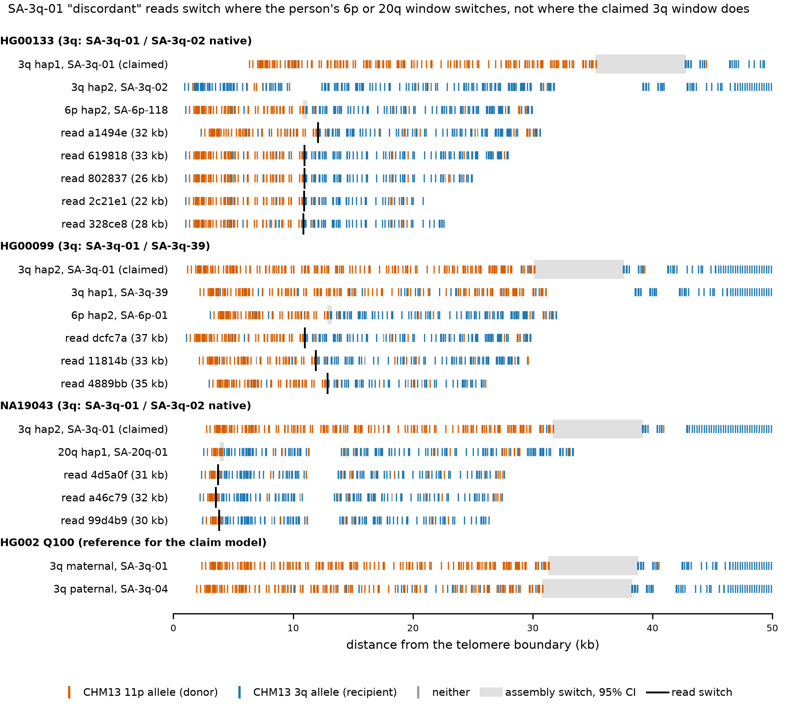
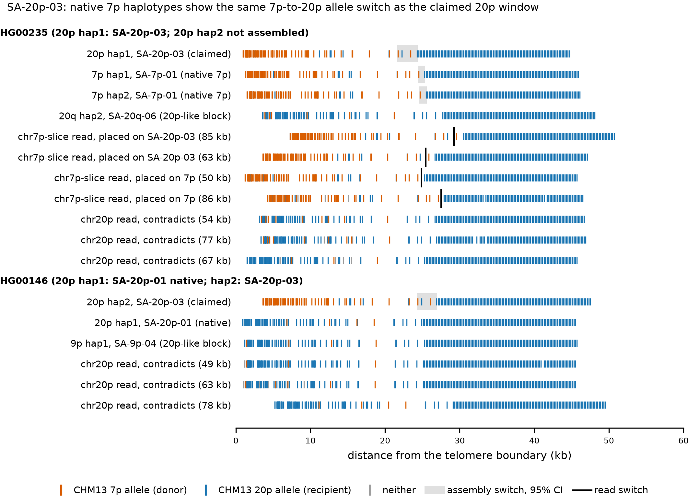

# Diagnostics of two flags in the 1000 Genomes ONT read evidence

This document is diagnosis only. The frozen criteria v1 ([../criteria_v1.json](../criteria_v1.json), hash `a89c5eaf023ed032`),
the module `atlas/subtel_atlas/readevidence.py` and the verdicts in [claims.tsv](claims.tsv) are unchanged. The tables and figures
below come from [../scripts/population_diagnostics.py](../scripts/population_diagnostics.py) and are written to
[diagnostics/](diagnostics/).

The main tool is **own-assembly placement**. Each read is aligned (minimap2 `map-ont` through mappy) to all Release 2 end windows
of the same individual (about 90 ends, 100 kb each). The window with the most aligned matching bases is the read's best end. The
claim's diagnostic-unit model is also applied, unchanged, to individual windows (the "projection", an error-free read). This tells
which chromosome end a read comes from. CHM13 alone cannot tell this, because other human haplotypes carry blocks that CHM13 lacks.

## Flag A: SA-3q-01, switch 17-28 kb distal to the assembly

**The flag.** 19 conclusive reads in 10 individuals place the 11p-to-3q switch at 3.5-13.7 kb. The claimed SA-3q-01 windows
place it at 29.9-42.7 kb. The model is donor CHM13 11p, recipient and comparator CHM13 3q, pattern DP.

**Which is right.** The assemblies are. The reads do not come from the claimed 3q end.



*Figure A ([pdf](diagnostics/fig_sa3q01_tracks.pdf)).* Diagnostic units by position from the telomere boundary: CHM13 11p allele
(orange), CHM13 3q allele (blue), neither (grey). Window tracks are the claim model applied to the person's own Release 2 windows;
the grey span is the window's switch (95% CI). Read tracks are conclusive 1KG-ONT reads; the black bar is the read switch. Each
read's switch coincides with the switch of the person's 6p window (SA-6p-118 or SA-6p-01) or 20q window (SA-20q-01), not with the
claimed 3q window. HG002 SA-3q-01 (maternal) is shown for reference; in calibration it was confirmed by 4 concordant ONT R10 UL
reads.

**1. Allele tracks** (Figure A, [sa3q01_window_projections.tsv](diagnostics/sa3q01_window_projections.tsv)).
* Every claimed SA-3q-01 window projects D:168-174 units then P, with the switch at 29.9-42.7 kb. HG002 maternal (SA-3q-01) and
  HG002 paternal (SA-3q-04) project the same way (31.3-38.8 and 30.8-38.3 kb).
* The reads carry 11p alleles only to about 11 kb, then 3q alleles.

**2. Haplotype of origin** ([sa3q01_discordant_reads.tsv](diagnostics/sa3q01_discordant_reads.tsv)).
* Best-placing window of the 19 reads:

  | best window | reads | alleles |
  |---|---:|---|
  | 6p end | 13 | SA-6p-01, SA-6p-118 |
  | 20q end | 3 | SA-20q-01 |
  | 9q end | 2 | SA-9q-14 |
  | 3q end | 1 | — |

  The single 3q placement (NA20503) is marginal: the read has higher identity to the person's 6p window than to the claimed 3q
  window, and its switch matches the 6p projection.
* For 17 of 19 reads, the read switch lies within the 2 kb concordance tolerance of the switch of its best-placing window under the
  same claim model:
  * SA-6p-01 and SA-6p-118 project at 10.9-13.7 kb;
  * SA-20q-01 hap1 of NA19043 projects at 3.9 kb;
  * SA-9q-14 of HG03130 projects at 5.1-5.3 kb.

  These are the switches the reads show (10.7-13.7, 3.5-3.8 and 5.1-8.0 kb).
* The 6p alleles SA-6p-01 (`PF03|PF04|20q|12p|20q`) and SA-6p-118 (`PF04|20q|12p|20q`, raw `PF03|PF04|...`) begin with an
  11p-like PF03 segment followed by a 3q-like PF04 segment. They are common: 86 and 74 ends in the catalogue.

**3. Other alleles in the same person.** The other 3q haplotypes do not explain the reads. Native SA-3q-02 windows (HG00133,
HG03130) show no switch (D:1 and D:3 units). SA-3q-39, SA-3q-40, SA-3q-04 and SA-3q-14 windows carry 11p alleles to about 30 kb,
like SA-3q-01. No 3q haplotype in these individuals switches near 11 kb.

**4. Donor model.** The model was re-run with donor CHM13 15q, the other PF03 member, coordinates transferred by alignment
([sa3q01_alt_donor_15q.tsv](diagnostics/sa3q01_alt_donor_15q.tsv)).
* Assemblies: D purity falls to 0.70-0.71 and the switch test fails.
* Reads: D purity falls to 0.52-0.70 and the switch test fails.
* The change points do not move: reads 3.5-13.6 kb, assemblies 31-36 kb.

11p is the better donor model. The donor choice does not cause the discordance.

**5. Unit density.** On the claimed HG00133 window there are 19-36 units per 5 kb from 5 to 35 kb, and 3 units in 35-40 kb. The
read switch near 11 kb lies in a dense region, so it is well identified. The sparse 35-40 kb interval only widens the assembly CI.

**6. R9 versus R10.** Median per-read rate of "neither" alleles at SNV sites:

| read set | median "neither" rate |
|---|---:|
| 1KG R9.4.1 conclusive, all | 3.2% |
| 1KG R9.4.1, the 19 discordant reads | 3.1% |
| HG002 R10 UL | 1.0% |
| HG002 R10 duplex | 0.5% |
| HG002 HiFi (2 reads) | 0.0% |

Median D-segment purity is 0.885 for the 19 reads, 0.939 for 1KG concordant reads and 0.983 for HG002 R10. The 19 reads have the
same error profile as every other 1KG read. Their switches sit at the positions predicted by specific non-3q windows. Sequencing
error does not explain them.

**Why the reads passed the per-read test.** In CHM13 the 3q-like stretch of these 6p/20q/9q haplotypes is closest to chr3.
* All 19 anchors are MAPQ 60 on chr3 but tier `mapq60_shared` with 0 unique bp: they lie in the outer 3q sequence that CHM13
  shares with other ends.
* 14 of the 19 anchors begin at the same CHM13 3q position, 17.6-17.7 kb from the end.
* CHM13's own 6p, 20q and 9q ends lack these blocks, so the read has no better CHM13 placement. The CHM13 anchor therefore cannot
  tell 3q from a non-CHM13 haplotype at another end that carries 3q-derived sequence.

The assembly-switch concordance requirement (criteria change C2) is what kept these reads from confirming SA-3q-01.

**Conclusion A: the reads are mis-assigned.** They come from 6p, 20q or 9q ends that carry an 11p-like tip followed by 3q-like
sequence. The flag is not allele heterogeneity at 3q, not a model or error limitation, and not an assembly error. None of the 31
SA-3q-01 claims is confirmed and none needs a verdict change. Their discordant reads are no evidence against the assembly switch
([diagnostics/claim_annotations.tsv](diagnostics/claim_annotations.tsv)).

**The same mechanism among confirmed claims.** All 220 conclusive rows were placed on the individual's full window set
([conclusive_read_placement.tsv](diagnostics/conclusive_read_placement.tsv)). 42 place best on another chromosome end: 29 of the 41
discordant rows and 13 of the 179 concordant rows. Classes of the 43 confirmed claims
([confirmed_claims_annotation.tsv](diagnostics/confirmed_claims_annotation.tsv)):

| class | claims | criterion |
|---|---:|---|
| robust | 27 | >= 2 concordant reads with a unique-tier anchor that also place on the claimed arm, allele-specific |
| shared anchor, on-arm placement | 11 | anchors only in CHM13-shared sequence, but >= 2 reads place on the claimed arm |
| not independently supported | 5 | see below |

* The 11 shared-anchor claims are mostly 2q SA-2q-02 (7 claims), plus 4q SA-4q-05 (2), HG00128 10p SA-10p-03 and HG00128 2q
  SA-2q-02 with one unique anchor each. Keep them, and note that the anchor lies in CHM13-shared sequence.
* The 5 not independently supported claims should be annotated:
  * HG00128 19p SA-19p-04: 1 of 2 reads places on 19p;
  * HG00323 15q SA-15q-02: 1 of 2 places on 15q; the other on 11p, the PF03 paralog;
  * NA20503 19p SA-19p-04: 0 of 3 place on 19p; all 3 place on the person's 3q window (SA-3q-04, PF04, the 3q/19p family);
  * NA21110 19p SA-19p-04: 0 of 4 place on 19p; all 4 place on 3q SA-3q-04;
  * HG00235 20q SA-20q-01: its 2 reads are also conclusive for SA-20q-06 of the other haplotype.

  The placement margins for HG00128, HG00323 and NA21110 are small (0.2-3.6% of aligned matches), as expected for PF03/PF04
  paralogs. NA20503's reads do not align to its 19p window at all. These
  claims rest on reads whose arm of origin is not resolved.

## Flag B: SA-20p-03, contradicting reads only

**The flag.** No conclusive read was found in 15 claims, against 32 contradicting reads in 5 of them; HG00235 alone has 18. The
allele's core structure is `7p|home|16q|PF02`. The claim model is donor CHM13 7p, recipient and comparator CHM13 20p, pattern DP,
assembly switch 14.1-16.7 kb.



*Figure B ([pdf](diagnostics/fig_sa20p03_tracks.pdf)).* As Figure A, with the CHM13 7p allele in orange and the CHM13 20p allele
in blue. The native 7p windows of HG00235 (SA-7p-01, both haplotypes) project the same 7p-then-20p pattern as the claimed
SA-20p-03 window, with the switch at the same place (about 24 kb). Carrier-like reads from the chr7p slice look the same whether
they place on SA-20p-03 or on native 7p. Contradicting chr20p reads look like the native 20p window and like the 20p-like blocks of
the 20q and 9p ends.

**Is the allele real? Yes.**
* SA-20p-03 is tier A, with 74 ends in 64 samples. Its evidence is recurrent, Verkko and pedigree (1 intact transmission).
* In the Tan crosswalk (`data/validation/tan2026_crosswalk.tsv`), 57 of 58 SA-20p-03 ends receive the same allele from an
  independent assembly (Verkko or hifiasm). This includes 14 of the 15 tested claim ends, each at 0.9997-1.0 identity.
* 14 of the 15 tested windows lie on contigs named as chr20. The 15th (NA20762) has a high-confidence arm probe.
* Carrier reads exist in the 1KG-ONT data. Among the chr7p donor-slice reads that pass the switch test, 23 place best on the
  person's SA-20p-03 window ([sa20p03_donor_slice_reads_placement.tsv](diagnostics/sa20p03_donor_slice_reads_placement.tsv)):
  * HG00235: 6 of 33;
  * HG00146: 3 of 15;
  * NA18960: 14 of 32.

  These reads are 30-91 kb long. Their proximal segments anchor on chr16 (11), chr7 (3), chr20 at MAPQ 2 (1), or nowhere (8).

**Where the contradicting reads come from.** Placement of all 32 reads, from the outer 60 kb of chr20p (see below):

| individual | reads | placed on |
|---|---:|---|
| HG00146 | 4 | the native 20p haplotype (SA-20p-01) |
| HG00146 | 5 | the 9p end, SA-9p-04 (`20p|home`) |
| HG00235 | 18 | the 20q haplotype 2 end, SA-20q-06 (`22q|20p|home`, a 20p-like block from 5 to 77 kb); HG00235's second 20p is not assembled |
| HG02155 | 1 | the native 20p haplotype |
| NA18570 | 2 | the native 20p haplotype |
| NA18960 | 2 | the 19p end, SA-19p-12 (`20p|9p`) |

None places on the claimed SA-20p-03 window. They are unphased reads from the other haplotype, or from other chromosome ends that
carry 20p-derived blocks; their 20p-like stretch anchors uniquely on CHM13 20p. This is flag A in the contradicting direction.

**Did the 5 kb slice miss carrier reads? No, not on chr20.** The outer 60 kb of chr20p was re-read for 8 carriers (595 reads at
least 5 kb; [sa20p03_wide60kb_reads.tsv](diagnostics/sa20p03_wide60kb_reads.tsv)). No read passed the switch test. The same 32
contradicting reads (identical read names) were found again.

**Is the claim model appropriate? No.**
* **What the mosaic shows.** In the claimed windows, the raw `7p` block (0-14.1 kb) and the following `home` block (14.1-44.4 kb)
  both have CHM13 7p as best end. Together they are collinear with CHM13 7p 3.4-48.6 kb. The `home` label is a 7p/20p tie
  (CHM13 7p and 20p are 96% identical over their outer 56 kb). The core block taken as the claim is therefore only the first 14 kb
  of a single 7p-like segment of about 44 kb.
* **How the D window cuts it.** The v1 D window is [d_lo - 10 kb, d_hi + 10 kb] = [0, 28.3 kb] on 7p. P-window positions beyond
  the D window's homologous block (27.5-48.3 kb on 20p, 20.8 kb) count as 20p-private, although CHM13 7p continues homologous
  there.
* **The resulting artefact.** In the claimed window, all 99 P units beyond 25 kb are such bins; 14-25 kb holds only 10 SNVs and
  4 bins. The assembly projection's switch (16.3-26.9 kb) is the edge of the D window, not a 7p-to-20p junction. Native 7p
  windows pass the same test with a switch at 24.2-29.1 kb. Under this model, the switch test cannot separate the allele from
  native 7p.
* **No reachable anchor.** The chr20-specific sequence of the haplotype lies beyond the 7p-like segment and the 16q, 9q, PF04,
  PF03 and PF02 blocks (to about 91 kb). A conclusive read would need to be more than about 100 kb long and anchor beyond them.
  Telomere-reaching 1KG-ONT reads at chr20p in these individuals have a median length of 16 kb and a
  maximum of 93 kb.

**Conclusion B: model limitation.** The allele is real and consistently assembled. The contradicting reads come from the other
haplotype or from other ends, not from the claimed haplotype. Under v1, a SA-20p-03 claim cannot be confirmed or contradicted by
reads. It should be read as not assessable, not as contradicted.

**Screen of all claims for the D-window-edge artefact** ([donor_window_edge_screen.tsv](diagnostics/donor_window_edge_screen.tsv)).
A claim is flagged when two conditions hold:
* its assembly switch lies within 3 kb of the end of the D window's homologous block;
* CHM13 D and P stay homologous (>= 85% identity) for at least 5 kb beyond the D window.

Of the 308 claims whose projection passes, 18 are flagged: SA-20p-03 (14), SA-3q-10 (2), SA-20p-41 (1) and SA-7p-09 (1). None is
confirmed or supported. 5 are `assessed_not_confirmed` (4 SA-20p-03 and HG00128 20p SA-20p-41, all `contradicting_only`); 13 are
already not assessable.

## Recommended annotations (reporting only)

[diagnostics/claim_annotations.tsv](diagnostics/claim_annotations.tsv) lists 107 claims with diagnostic notes and a recommendation:

| recommendation | claims |
|---|---:|
| confirmed, keep | 27 |
| confirmed, keep, note CHM13-shared anchor | 11 |
| confirmed, annotate: reads not attributable to the claimed end | 5 |
| treat as not assessable under v1 (D-window edge) | 18 |
| contradicting-only, no contradiction of the claimed haplotype | 31 |
| discordant reads come from another chromosome end | 13 |
| review: a contradicting read places on the claimed end | 2 |

* **Contradicting-only claims.** Across all 38 such claims, 117 contradicting reads place as follows (2 on the claimed end, 59 on
  the other haplotype of the same arm, 56 on other chromosome ends;
  [contradicting_read_placement.tsv](diagnostics/contradicting_read_placement.tsv)):

  | placed on | reads |
  |---|---:|
  | the claimed end | 2 |
  | the other haplotype of the same arm | 59 |
  | another chromosome end | 56 |

  No claim warrants a `contradicted` annotation. The 2 to review are HG03521 17q SA-17q-02 (same allele on both haplotypes) and
  HG03742 9p SA-9p-08, with 1 such read each.
* **Discordant claims.** 13 of the 17 `discordant` claims have discordant reads that place on another chromosome end.
* **Future criteria (v2).** Two changes would have removed both artefacts:
  * an anchor test that either requires the unique tier or adds the own-assembly placement line;
  * a D window that extends while CHM13 D and P stay homologous.

  These are suggestions for a new registration. They were not applied here.

## Evidence BAM headers

| BAM set | location | files | local paths in header |
|---|---|---:|---|
| population evidence | `work/evidence/population/bam` | 72 | none |
| HG002 evidence | `work/evidence/hg002/evidence_bam` | 2 | in @PG CL lines |
| HG002 evidence | `work/readevidence/evidence_bam` | 2 | in @PG CL lines |
| CLI test | `work/readevidence/cli_test` | 1 | in @PG CL lines |
| fetched slice BAMs | `work/` | about 2,000 | in the samtools `@PG CL` lines |

* The population evidence BAMs were written with neutral `@PG` lines and `samtools sort --no-PG`.
* The HG002 evidence BAMs carry absolute paths of the local machine and of a scratch directory in their `@PG CL` lines.
* The fetched slice BAMs are not meant for publication.
* [../scripts/sanitize_bam_headers.py](../scripts/sanitize_bam_headers.py) writes copies whose header paths are reduced to file
  names. Sanitised copies of the 4 HG002 evidence BAMs are in `work/evidence/sanitized/`, with read counts unchanged
  (17, 17, 449, 222) and no paths in the headers. The originals were not modified.

## Reproduce

```
source work/config.local.sh; export PYTHONPATH=atlas
python evidence/scripts/population_diagnostics.py -t 5          # about 9 min; re-reads chr20p:1-60000 for 8 samples from IGSR
python evidence/scripts/sanitize_bam_headers.py --out work/evidence/sanitized/hg002_evidence_bam work/evidence/hg002/evidence_bam/*.bam
```
