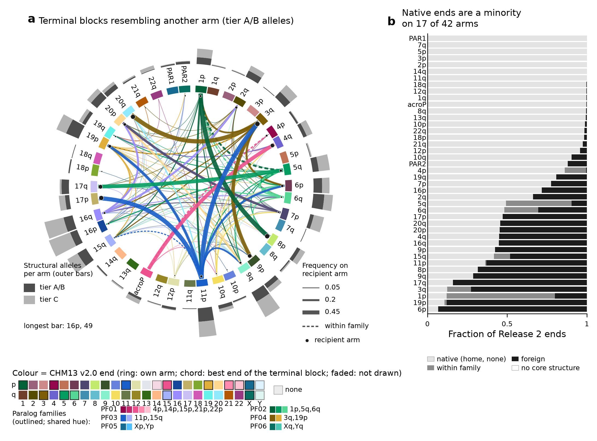
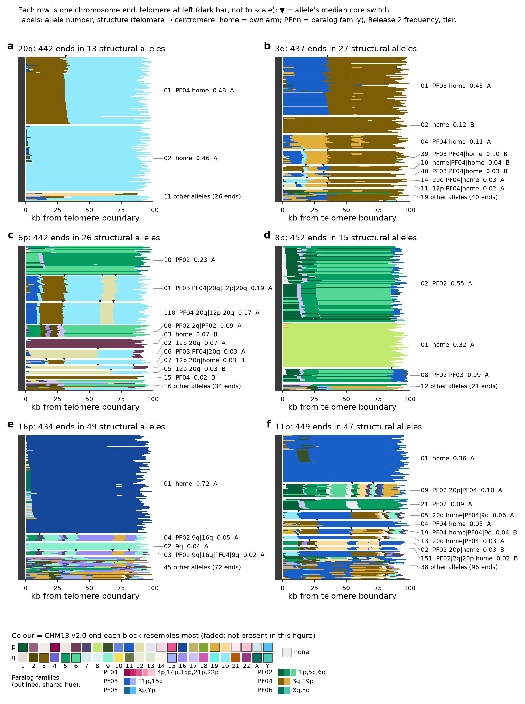
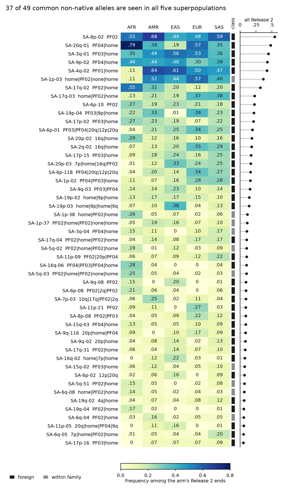
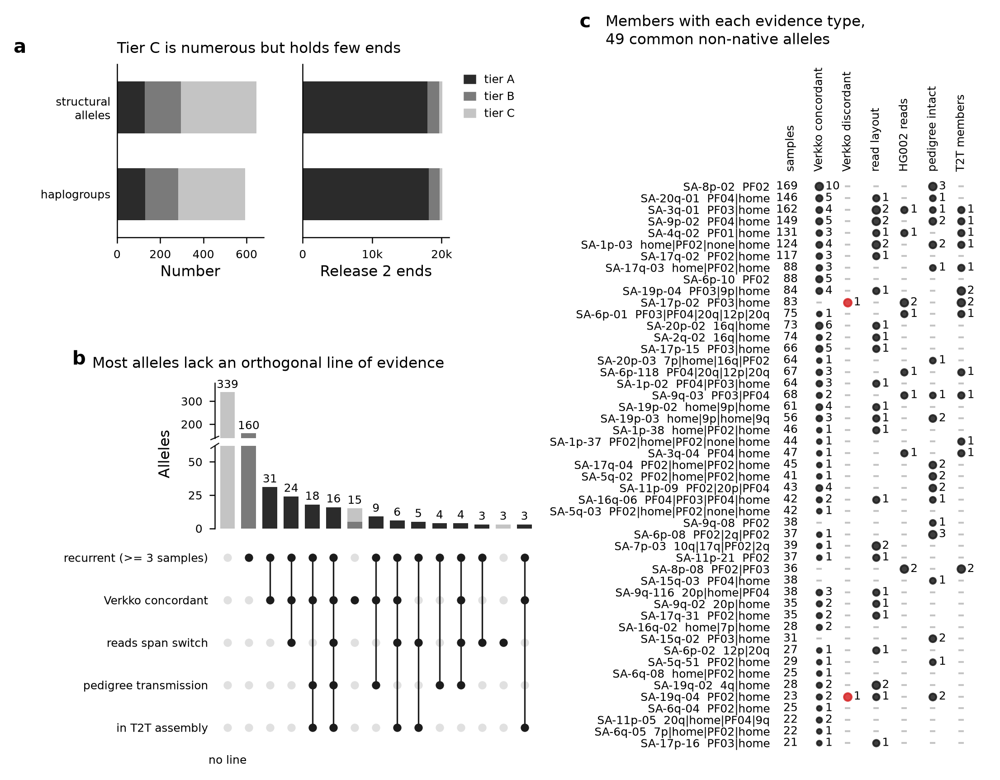
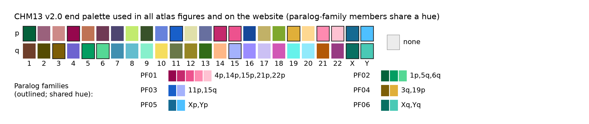

# Atlas figures - captions

Generated by `pipeline/figures_atlas.py` from the catalogue v0.1 release tables. Each figure is provided as PNG (300 dpi), PDF and SVG.

## F1_genome_overview

**Figure 1 | Genome-wide organisation of structural alleles at human chromosome ends (catalogue v0.1).** (a) The 42 catalogue arms (pooled groups: acroP = 13p/14p/15p/21p/22p, PAR1 = Xp/Yp, PAR2 = Xq/Yq) in genome order, clockwise from 1p; ring colour = the arm's own CHM13 v2.0 end (pooled groups: 15p, Xp, Xq). Outer bars: structural alleles per arm, tier A/B and tier C (longest bar 16p, 49; 647 alleles in total). Chords: the 4410 Release 2 ends in tier A/B alleles whose outermost core block (>= 10 kb from the telomere boundary) is labelled neither home nor none, grouped by recipient arm and by the best single CHM13 end of that block into 149 pairs; chord colour = that best end, dot = recipient arm, width = fraction of the recipient arm's Release 2 ends with a structural-allele call; dashed = mostly within-family ends (10 pairs), i.e. the block is closer to another member of a paralog family that contains the arm itself. Largest: 3q>11p 0.51; 8p>1p 0.50; 20q>3q 0.48; 17p>11p 0.48. Blocks are labelled by paralog family in the catalogue (e.g. PF04 = 3q/19p); the chord is drawn to the block's best single end. Labels are relative to CHM13: the switch to home sequence lies inside shared paralogous sequence and is not necessarily a structural breakpoint. (b) Nativity class of each arm's Release 2 ends (n = 426-2049 per arm; acroP pools five arms), from the end's own core structure: native = only home and none blocks; within family = non-home blocks all in a family containing the arm; foreign = at least one block from another family or arm. All Release 2 ends: native 14461, within family 747, foreign 4936, no core structure 0. Arms with native fraction < 0.5: 6p, 19p, 1p, 3q, 17q, 9q, 8p, 11p, 15q, 9p, 16q, 4q, 20p, 20q, 17p, 6q, 5q. Source: data/catalogue/alleles_structural.tsv, ends.tsv, mosaic_blocks.tsv, paralog_families.tsv.

## F2_allele_mosaics

**Figure 2 | Terminal mosaics of real chromosome ends, grouped by structural allele.** For six arms, every Release 2, CHM13 and HG002 Q100 end assigned to a structural allele of the arm is drawn as one row (pedigree validation ends are not drawn). Blocks are the raw mosaic blocks of mosaic_blocks.tsv (labels from per-base identity tracks on a 100 bp grid, base-level switch refinement), coloured by their best single CHM13 v2.0 end (column best_end; members of a paralog family share a hue and differ in lightness, see key); home blocks carry the arm's own colour even where a paralog is tied within the home margin (pooled groups: the member end); grey = none, no CHM13 end within 0.80 identity, in subtelomere coordinates (0 = telomere/subtelomere boundary; the telomere is drawn as a fixed-width dark bar, not to scale); white = beyond the end of a contig shorter than the 100 kb window. Ends are grouped by structural allele (defined on core blocks >= 10 kb; alleles with >= 10 ends are shown separately, the remainder pooled as 'other alleles' and sorted by structure) and ordered within a group by the first raw switch; leaders keep the order of the groups. Triangles above each group mark the allele's median core switch positions. Labels: allele number (SA-<arm>-NN), core structure (home, paralog family PFnn, CHM13 arm or none per core block), Release 2 frequency (r2_freq) and tier. Ends per arm: 20q 442 (13 alleles), 3q 437 (27 alleles), 6p 442 (26 alleles), 8p 452 (15 alleles), 16p 434 (49 alleles), 11p 449 (47 alleles). Block labels are relative to CHM13: inside paralogous subtelomeric sequence a colour change is a change in which CHM13 end is most similar, not necessarily a structural breakpoint; short raw blocks inside a group (< 10 kb) do not change the allele call. Source: data/catalogue/ends.tsv, mosaic_blocks.tsv, alleles_structural.tsv.

## F3_population_frequencies

**Figure 3 | Frequencies of the common non-native structural alleles by 1000 Genomes superpopulation.** Rows: the 49 tier A structural alleles of nativity class foreign or within family with Release 2 frequency >= 0.05 (39 foreign, 10 within family; class strip left of the cells), with allele ID and core structure (telomere -> centromere; 'home' = the arm's own sequence, PFnn = paralog family, none = no CHM13 end within 0.80 identity), ordered by overall frequency. Cells: carrier ends / Release 2 ends of the arm with a structural-allele call in that superpopulation (denominators 50-145 ends per arm and superpopulation; allele_frequencies_by_superpop.tsv); right: all Release 2 ends. 37 of 49 alleles are observed in all five superpopulations. Largest AFR vs mean non-AFR differences: SA-4q-02 -0.44; SA-20q-01 +0.41; SA-1p-03 -0.37. Frequencies are descriptive; AMR and part of AFR (ACB, ASW) are admixed; formal tests of population differentiation for terminal forms are in analyses/allele_ages.

## F4_validation

**Figure 4 | Evidence tiers and lines of evidence.** (a) Structural alleles (647: tier A 129, B 166, C 352; 284 singletons) and sequence haplogroups (593; A 131, B 152, C 310), as counts and as the number of Release 2 ends they contain: tier A alleles hold 17972 and tier A/B 19681 of the 20108 Release 2 ends with a structural-allele call (97.9%). (b) Combinations of evidence lines per structural allele (UpSet layout; bars stacked by tier on a broken linear axis; 339 alleles have no evidence line and 160 only recurrence; combinations with < 3 alleles, 7 alleles in total, are omitted). Tiers: A = recurrent (>= 3 unrelated samples) and >= 1 orthogonal line, or >= 2 orthogonal lines; B = recurrent without an orthogonal line, or 2 samples with >= 1 orthogonal line; C = all others. Orthogonal lines: a member's Verkko assembly agrees; HG002 Q100 ONT reads cross the switch or a hifiasm read layout supports the end; intact parent-to-child transmission in the WashU pedigree; a member in HG002 Q100 (or CHM13 for non-native alleles). (c) For the 49 common non-native alleles of Fig. 3, members with each evidence status (dot area scaled within column; number = count; first column = samples; red = Verkko-discordant members, 2 in total against 112 concordant). A missing orthogonal line mostly reflects that few ends were testable (Verkko assemblies and read layouts exist for a subset of samples; HG002 and the pedigree are single families), not contrary evidence. Source: data/catalogue/alleles_structural.tsv, haplogroups.tsv.

## palette_chm13_ends

**Palette.** One colour per CHM13 v2.0 chromosome end (48), produced by pipeline/atlas_palette.py. Members of a paralog family (data/catalogue/paralog_families.tsv; outlined in the key) share one hue and differ in lightness, so a family-labelled block reads as its family whichever member is its best single end; every other end has its own colour. Colours were chosen once (seeded optimisation) to maximise the CIEDE2000 difference, in normal vision and in simulated deuteranopia (Machado et al. 2009, doi:10.1109/TVCG.2009.113), between CHM13 ends that are adjacent or co-occur in the catalogue mosaics; pairwise values in figures/atlas/palette_qc.tsv. For the 161 pairs of different families or ends with co-occurrence weight >= 50, minimum dE2000 is 9.1 (simulated deuteranopia 8.2); over all 1111 such pairs 9.1; between shades of one family >= 11.4. Grey = none (no CHM13 end within 0.80 identity). Hex codes: figures/atlas/PALETTE.tsv.

