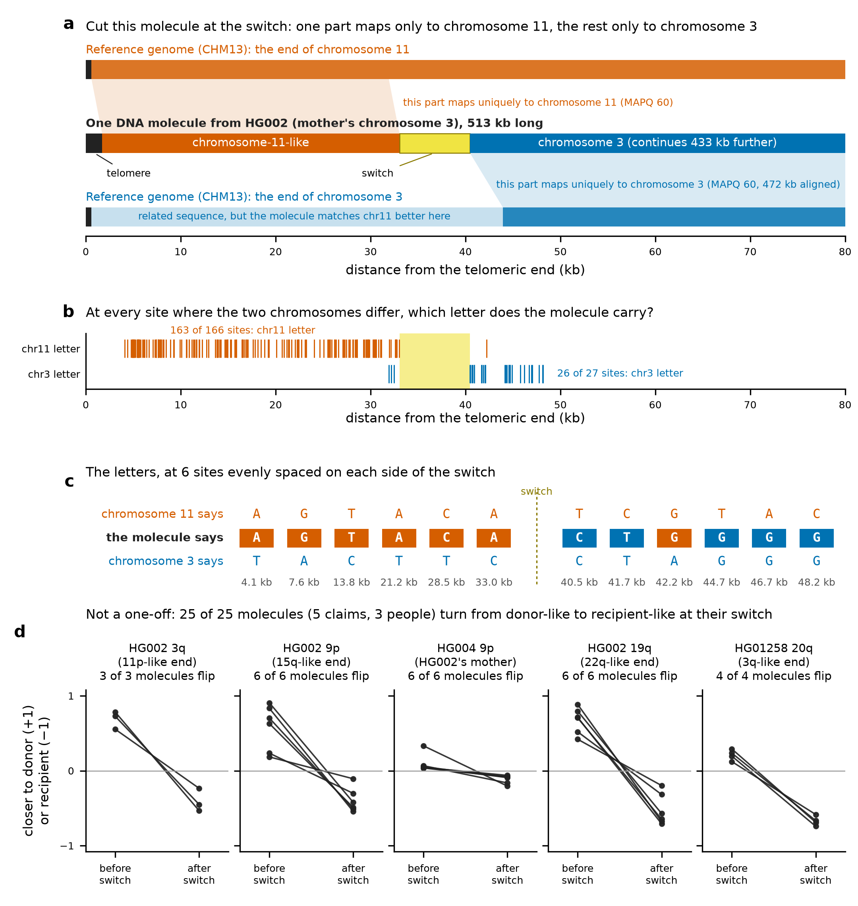
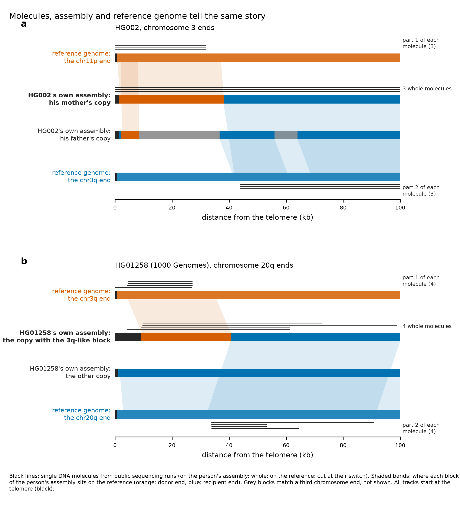
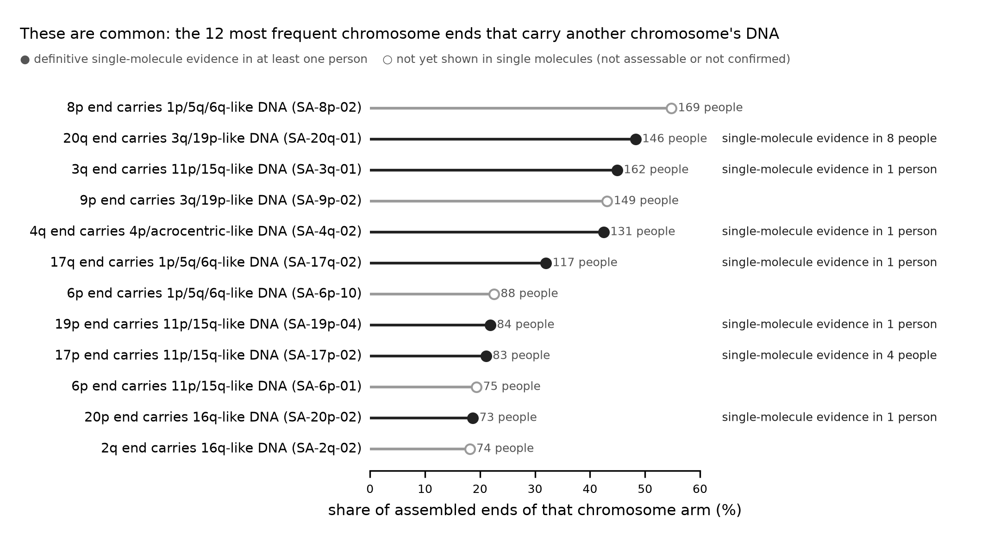

# Chromosome ends borrow from each other, and single DNA molecules show it
*A two-minute introduction to the human subtelomere atlas and the evidence behind it · October 2026 · atlas v0.1 · read-evidence criteria v1*

## Summary

- **The finding.** The DNA just inside a chromosome's telomere often looks like the end of a *different*, unrelated chromosome. All 230 people in the Human Pangenome Reference Consortium Release 2 carry such ends: a median of 21 (range 7-34) of their roughly 90 assembled chromosome ends, 4,936 of 20,144 ends in all.
- **They are common.** They are recurring variants, not one-off rearrangements. One version of the 20q end, resembling the 3q/19p end, is found in 146 of 230 people (48% of assembled 20q ends).
- **Why believe it.** Because a single DNA molecule reads it end to end. A 513 kb nanopore read from HG002 starts in the telomere, carries chromosome 11's letters at 163 of 166 diagnostic sites, then switches and runs for 472 kb along chromosome 3.
- **Not a one-off.** 15 of 15 HG002 claims confirmed under the pre-registered criteria are definitive (301 molecules; 12 seen in two or more independent datasets). HG002's parents confirm 4. Independent 1000 Genomes data give 24 definitive claims in 14 more people.
- **We tried to break it.** The criteria were frozen before any population read was examined. 0 of 1,307 negative-control tests passed them. All 88 common, well-supported alleles recur in four independent cohorts (Tan et al. 2026).
- **Check it yourself.** Any claim can be re-derived from public reads with one command: `evidence/replicate_claim.sh CLAIM_ID`.

## 1. What we looked at

Each chromosome ends in a telomere, a long run of the six letters TTAGGG. The 100 kb just inside it, the **subtelomere**, is made of blocks that are shared, in near-identical copies, between different chromosome ends. The reference genome (T2T-CHM13) shows one version of each end. We compared the subtelomeres of 20,144 chromosome ends from 230 people with the 48 CHM13 ends and labelled each block by the CHM13 end it matches best. An end is **foreign** if one of its blocks best matches the end of an unrelated chromosome (not a known near-identical partner). That is true of 25% of all ends; in 88% of them it is the block right next to the telomere. The same versions recur in many unrelated people. The atlas catalogues them as structural alleles, such as SA-20q-01.

A skeptic's first question: are these real chromosome ends, or assembly mistakes? Assemblies are stitched together from many reads, and stitching inside near-identical sequence is exactly where assemblers can go wrong. So we asked the reads directly, one molecule at a time.

## 2. One molecule tells the story

**Figure 1. A single DNA molecule joins chromosome-11-like sequence at the telomere to chromosome 3.** (a) Nanopore read `3788f60a-2f28-4b28-917b-f1ecae3645e3` (ont_ul_dorado, HG002 Q100 public alignments; 513 kb), drawn to scale over its first 80 kb against the CHM13 ends of chromosome 11 (p arm) and chromosome 3 (q arm). Cut at the switch, its distal part aligns to CHM13 chr11:600-31,925 and its proximal part to chr3:200,589,764-201,062,020, both at MAPQ 60. (b) Every diagnostic site (a position where the CHM13 chr11 and chr3 copies differ) covered by the two aligned parts: tick colour = which chromosome's letter the molecule carries. Yellow: 95% interval of the switch. (c) The letters at 6 sites evenly spaced on each side; the one chr11 letter after the switch is shown as found. (d) Every molecule of five showcase claims, compared in 2 kb windows with the donor and recipient CHM13 ends: closeness index (d_recipient - d_donor)/(d_recipient + d_donor), where d = differences per 1,000 aligned letters, median of windows before and after the switch. 25 of 25 molecules flip. Not shown: the HG002 and HG01258 17p claims (0 of 3; 0 of 5 molecules flip), whose 11p-like block is rich in tandem repeats, so 2 kb windows align poorly to both ends, and NA20346 2q (0 of 2), whose switch at 7-8 kb leaves too few windows. All eight claims are confirmed by the formal diagnostic-site test. Data: report/pitch_data/.

**How to read Figure 1.** (1) The molecule starts with telomere, so it really is the end of a chromosome. (2) Its next 31 kb carries chromosome 11's letters, not chromosome 3's: 163 of 166 sites. (3) After the switch it carries chromosome 3's letters (26 of 27) and keeps going, uniquely in chromosome 3, for another 472 kb. No assembly was involved: this is one physical molecule from a public sequencing run, and the reference genome is used only as a ruler.

The same picture holds molecule after molecule (Figure 1d). It holds in different sequencing technologies (Oxford Nanopore R9 and R10, PacBio HiFi), at different chromosome ends, in different people, and in HG002's mother HG004, who passed the 9p end on.

**Figure 2. Molecules, assembly and reference genome tell the same story.** Each panel stacks four tracks, all starting at the telomere: the CHM13 reference end the claim names as donor (top), the person's own two assembled copies of the chromosome end (middle; claimed copy in bold) and the CHM13 end of the chromosome itself (bottom). Shaded bands place each block of the person's assembly on the reference end its catalogue label names (minimap2 asm10). Black lines are single DNA molecules from public sequencing runs that were not used to build the assemblies: whole, on the claimed copy; cut at their switch interval (criteria v1), part 1 aligned to the donor end and part 2 to the recipient end. (a) HG002 chromosome 3q: 3 molecules of the claim HG002#2#chr3_MATERNAL#R. (b) HG01258 chromosome 20q, allele SA-20q-01: 4 1000 Genomes nanopore molecules of the claim HG01258|20q|SA-20q-01. Tracks are cut at 100 kb. The interactive version of every definitive claim is the guided tour on the project website.

## 3. Common, inherited and replicated

**Figure 3. The most frequent foreign chromosome ends.** The 12 foreign structural alleles with the highest Release 2 frequency (share of the arm's assembled ends). People = distinct individuals carrying the allele. Filled markers: at least one claim for this allele is definitive at read level; open markers: no definitive claim yet. This means not testable with the available reads or not confirmed; it is not evidence against the allele.

SA-20q-01 is the clearest case: 146 people carry it, and independent 1000 Genomes nanopore reads show it in single molecules in 8 of them. SA-3q-01, the allele of Figure 1, is carried by 162 people. These versions are old: switch points are shared across unrelated people and continental groups. They are also reproducible: classifying 11,175 subtelomere sequences from four independent cohorts (HGSVC3, CPC, APC, JASA; Tan et al. 2026) with the same method finds all 88 common tier-A alleles again, and non-native allele frequencies agree with Release 2 at r = 0.97.

## 4. How hard we tried to break it

| Test | The worry it addresses | Result |
|---|---|---|
| Criteria frozen before looking | Moving the goalposts after seeing the data | Criteria v1 committed (git 673b77b) before any population read was inspected; a stricter "definitive" tier added later can only remove claims |
| Negative controls | Does the test call anything foreign? | 0 of 297 HG002 other-haplotype tests and 0 of 1,010 1000 Genomes native-individual tests passed (95% upper bounds 1.0% and 0.30%) |
| Independent sequencing runs | An artefact of one run or one chemistry | 12 of 15 definitive HG002 claims seen in two or more independent datasets |
| Inheritance | Assembly errors are not inherited | 4 HG002 claims confirmed in the reads of the parent who passed the chromosome on |
| Second assembler | An artefact of one assembler | Same haplotype assembled independently with Verkko (Tan et al.) gives the same structural allele 96.4% of the time |
| Independent cohorts | Something specific to Release 2 | 88/88 common tier-A alleles recur in four cohorts; frequencies r = 0.97 |
| Re-derivation from public data | "Trust us" | 9 of 9 clean-tree re-runs of evidence/replicate_claim.sh reproduce the published verdict read for read |

## 5. What this does and does not show

"Foreign" is defined relative to the reference genome: a block is labelled by the CHM13 end it resembles most, and CHM13 itself carries one version of each end. A "switch" is where the best match changes. It usually lies inside sequence that both ends share, so it marks a change in resemblance, not necessarily a breakpoint. Read-level proof needs long, telomere-reaching molecules: 639 of 822 population claims could not be tested with the available 1000 Genomes reads, which says nothing against them. The window comparison in Figure 1d is an illustration; verdicts rest on the pre-registered diagnostic-site test (evidence/CRITERIA.md).

## 6. Check it yourself

Showcase molecules, with IGV sessions and a "what you should see" note for each: evidence/showcase/. Every cited read, with the exact `samtools` command that fetches it from the public file: evidence/reads.tsv.gz. Re-derive a verdict from public data: `bash evidence/replicate_claim.sh 'HG01258|20q|SA-20q-01'`. Full details: evidence/READ_EVIDENCE.pdf; the catalogue, query tool and website: https://jlanej.github.io/human-subtelomere-atlas/.

## References

- Nurk S, et al. (2022). The complete sequence of a human genome. *Science* 376:44-53. doi:10.1126/science.abj6987
- Liao W-W, et al. (2023). A draft human pangenome reference. *Nature* 617:312-324. doi:10.1038/s41586-023-05896-x
- Schloissnig S, Pani S, et al. (2025). Structural variation in 1,019 diverse humans based on long-read sequencing. *Nature*. doi:10.1038/s41586-025-09290-7
- Zook JM, et al. (2016). Extensive sequencing of seven human genomes to characterize benchmark reference materials. *Scientific Data* 3:160025. doi:10.1038/sdata.2016.25
- Tan et al. (2026). Widespread structural variations at human chromosome ends. bioRxiv. doi:10.64898/2026.09.03.748401
